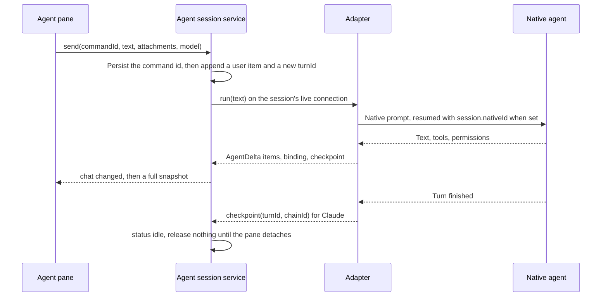
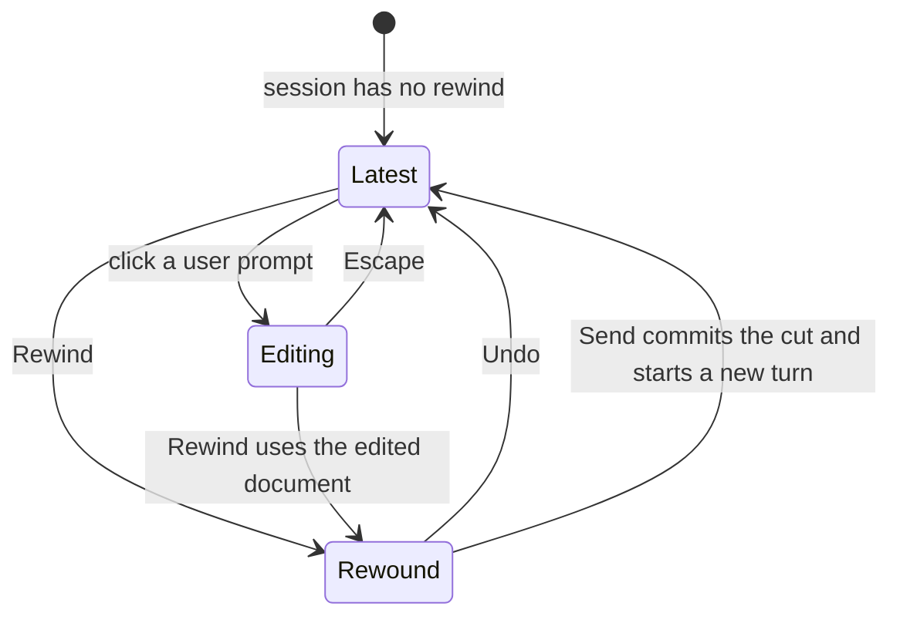

# Agent pane rewind

Status: implemented. Research is from the current checkout: `packages/core/src/chat.ts`, `packages/mux/src/agents/service.ts`, the three adapters, `apps/desktop/src/renderer/src/components/chat/`, and the installed Claude Agent SDK 0.3.287 types. Pi's tree behavior is from the current `earendil-works/pi` main RPC types and `rpc-mode.ts` handler, plus the sessions doc. Codex still has no rewind method in this repo, and that CLI is not installed here.

This is the first slice of the rewind work that [the chat plan](agent-chat-plan.md) deferred. It is not a branch tree. Fork already copies a prefix into a new session. Rewind stays on the same session, puts the chosen prompt back in the composer, and can be undone until the next send.

## 1. What ships

On each user prompt, Rewind is the icon to the left of Copy:

- **Rewind** hides that prompt and everything after it, and loads that prompt into the composer at the bottom of the pane.
- Clicking the prompt itself makes it editable first, with the same composer document the bottom field uses. Rewind then uses that edited text.
- **Undo** is one line directly under the response that remains (the response before the prompt that was rewound). It restores the latest turn and the composer draft that rewind displaced.

Sending while a rewind is pending commits it. The hidden tail is dropped, and the new turn continues from the kept prefix. Undo is no longer available after that send.

Workspace files are not restored. See section 7.

## 2. How a session works today

One agent pane is bound to one `AgentSession`. The pane id is not the session id. The host keeps the session in `CEREBRO_HOME` as `session-<id>.json` and tells the renderer only that the workspace changed. The renderer refetches the whole snapshot. There is no delta stream to patch.



Identities that matter for rewind:

| Identity | Where it lives | What rewind must respect |
| --- | --- | --- |
| Session | `AgentSession.id` | Rewind does not create a session. Fork does. |
| Turn | `ChatItem.turnId`, also `session.turnId` while that turn is current | One accepted user request and the work it causes. A steered follow-up is another user item on the **same** turn. |
| Item | `ChatItem.id` | The transcript is `session.items` in order. User prompts are `kind: 'user'`. |
| Native binding | `session.nativeId` | The next turn resumes this id. The rendered items are not what the model remembers. |
| Checkpoint | `session.checkpoints[turnId]` | Claude only. The last top-level assistant message uuid of that turn (`chainUuid` in `claude.ts`), written when the turn's `result` succeeds. |
| Command id | `session.commands` | Accepted sends are not replayed. Rewind must not re-send the hidden prompts. |

`beginTurn` in `service.ts` is the only way a user turn starts. It allocates a new `turnId`, pushes one user item, and calls `connectionFor(session).run(...)`. The connection is reused across turns until access mode or cwd changes. Claude's `query()` options pass `resume: session.nativeId` and nothing else, so a resume always loads the full native chain.

The renderer groups that list into turns in `chat-turns.ts`. The first item of a `turnId` is the scroll anchor. `ChatTurnActions` (copy response, fork) renders after the last item of a finished turn, under the "End of response" rule. That is a different control from the prompt's Copy button.

## 3. The prompt row today

`ChatItem` renders `kind: 'user'` as `ChatUserMessage`. The bubble is right-aligned. Its body is `ComposerMessage`, the read-only TipTap document built with `textToContent`, so tags and image chips match what was sent. Under the bubble there is one ghost icon button, Copy. It copies `item.text` and toasts.

`ComposerEditor` is the editable field in the docked composer (`chat-view.tsx`). It shares extensions with `ComposerMessage` (`composer-document.ts`: marks, tags, fenced code, image chips). The docked field also owns the model picker, access mode, vim badge, attach control, and Enter-to-send. Draft text is mirrored to `localStorage` per pane by `useComposerDraft`.

Clicking a prompt does nothing today. Image thumbnails open a preview. That click must keep doing that.

## 4. Interaction



### 4.1 Click the prompt

The bubble swaps `ComposerMessage` for `ComposerEditor` in a message variant:

- Same extensions, same serialization, same image chips.
- Shorter chrome. No model picker, no access control, no queue, no glow shell.
- Enter inserts a newline. It does not send. Vim, when enabled, uses the same plugin as the docked composer.
- Escape leaves edit mode and throws away the uncommitted edit. `session.items` does not change.
- Copy still copies the stored prompt, not the half-edited document.

This edit is local to the bubble. It exists so someone can fix the prompt before rewinding. There is no separate Save. The only way the edit leaves the bubble is Rewind.

### 4.2 Rewind

Rewind is the icon button beside Copy, on every user bubble, including a steered user item.

1. Read the text and attachments from the inline editor if it is open, otherwise from the stored user item.
2. Remember the docked composer's current draft.
3. Ask the host to cut the transcript so that every item before this user item stays, and this item onward is held aside.
4. Load that prompt into the bottom `ComposerEditor`, replacing the draft, and focus it.
5. Render one line under the last kept response: a short description and an Undo button on that same line.

The transcript, the turn rail, and fork all see the kept prefix only. The hidden tail is not rendered. The bottom composer is the only place the rewound prompt is edited after the click. The bubble that was rewound is no longer on screen.

Rewinding again while one rewind is already pending moves the cut earlier or later. The held tail is always "everything after the current cut, through the original tip." Undo still returns to that original tip, not to the previous cut. One pending rewind, not a stack.

### 4.3 Undo

Undo is the button on that one transcript line, not a control on each prompt and not a bar above the composer. It is available only while `session.rewind` is set.

Pressing Undo puts the session back to how it looked before the rewind:

- `session.items` is the full transcript again, including the tail
- the native binding and checkpoints are the ones from the tip
- the bottom composer is the draft rewind replaced, or empty when there was no draft
- the one-line Undo row is gone

Nothing is sent.

### 4.4 Send while rewound

Send uses the existing `send` command. The service sees `session.rewind` and treats the send as the commit:

- The tail is discarded.
- `session.rewind` is cleared.
- `beginTurn` appends the new user item after the kept prefix.
- The adapter resumes native memory at the cut, per section 6. A harness that cannot do that starts a new native session and the transcript gains a notice saying so.

A failed send leaves the rewind in place so Undo still works. The command id is still recorded, matching today's rule that an accepted command is not replayed. If dispatch never started, the command id is not kept, same as a failed `beginTurn` setup.

## 5. Composer reuse

Do not add a second editor. `ComposerEditor` gains a `variant` and a `replace` handle.

|  | Docked composer (`variant="composer"`, the default) | Prompt bubble (`variant="message"`) |
| --- | --- | --- |
| Component | `ComposerEditor` | `ComposerEditor` while editing, `ComposerMessage` otherwise |
| Document | `textToContent` / `serializeDocument` | same |
| Enter | send | newline |
| Model, access, attach row | yes | no |
| Initial content | pane draft from `localStorage` | the user item |
| After Rewind | `replace(text, attachments)` | bubble unmounts because that item is in the tail |

`replace` is required. `defaultText` is only read when the editor mounts, and remounting the docked field would fight the localStorage effect in `useComposerDraft`.

Attachments on a rewound prompt are already on disk under the session attachment directory. The renderer loads bytes with the existing `chatAttachment` call and passes them to `replace` as composer uploads. Rewind does not copy the files.

The inline editor and the docked editor are two instances. Only one is edited at a time: opening the bubble does not clear the dock, and Rewind is what moves the document down.

## 6. Host state

Add one optional field. Do not delete items as the only copy.

```ts
type SessionRewind = {
  /** User item the cut starts at. */
  itemId: string
  turnId: string
  /** Items from that user item through the original tip, in order. */
  tail: ChatItem[]
  /** Native binding of the tip, so Undo can put it back after a failed commit. */
  nativeId?: string
  checkpoints?: Record<string, string>
  /**
   * Native cut point. Claude: chain uuid of the last kept turn.
   * Pi: entry id of the user message being rewound; `fork` branches before it.
   * Absent when the kept prefix has no native point (the first prompt).
   */
  resumeAt?: string
  /** Docked composer draft displaced by the prefill. Text only; attachment bytes stay in the pane draft store. */
  displacedDraft?: string
}
```

`AgentSession.rewind?: SessionRewind`.

`rewind` command:

- Reject while `status` is `running` or `waiting` (`Stop the running turn before rewinding.`), same gate as fork.
- Reject while `queue` is non-empty (`Remove queued messages before rewinding.`).
- Reject while any background task is `running`. Those tasks belong to the live process and to the tail.
- Reject when `itemId` is not a `kind: 'user'` item still in `items` (or already the current cut).
- Slice `items` at that item. The kept prefix is `items.slice(0, index)`. The tail is the rest.
- Set `resumeAt` from the checkpoint for that cut (section 6.1).
- Claude and Codex leave `nativeId` unchanged until a send commits, and the live process is closed (`release`) so the next turn cannot resume the uncut chain by accident. Pi moves the native binding on rewind itself (section 6.3), because that is when `fork` creates the branched session file.
- Publish. The snapshot the renderer refetches already omits the tail from `items`.

`undo` command:

- No-op success when `rewind` is absent.
- Reject while busy, same as rewind.
- Concatenate `tail` back onto `items`, restore `nativeId` and `checkpoints`, delete `rewind`, publish. Pi also `switch_session`s to the restored path before that publish.

Commit, inside the existing `send` path, before `beginTurn`:

- Drop `rewind.tail`.
- For Claude, pass `resumeAt` into the next `query` (section 6.2). On the binding event for the new process, store the new `nativeId`.
- For Pi, the rewind command already branched the session file. Send is an ordinary prompt on that binding. Do not fork again.
- For an emulated harness, clear `nativeId` and append a notice item on the kept prefix: `This agent cannot rewind its own memory. The next message starts a fresh session.`
- Delete `rewind` only after the native resume options are fixed on that run. A throw before `beginTurn` keeps `rewind` so Undo still restores the tip.

The tail stays inside the same snapshot. Moving rows from `items` to `rewind.tail` does not grow the file. The 2 MB / 2,000 item ceiling still applies to the whole snapshot.

### 6.1 Where the cut is allowed

A turn can contain more than one user item. Steering pushes another `kind: 'user'` row onto the running `turnId`. Checkpoints exist only at the end of a successful turn, and `resumeSessionAt` keeps messages up to and including that uuid. A cut in the middle of a turn would leave earlier items of that turn on screen while the native resume point is the previous turn. The model would not see the kept half.

Claude checkpoints exist only at the end of a successful turn, so a steered user item is refused: `Rewind from the prompt that started this response.` Pi stores an entry id on every user message it can fork, including a steered one, so that cut is accepted (section 6.3).

The first prompt of a session has no previous checkpoint. `resumeAt` is absent. Claude and Codex start a new native session and clear `nativeId`. Pi's `fork` of the root user message creates an empty session whose parent is the old file. The transcript is empty until the new send.

### 6.2 Claude native resume

Capability: `rewind: 'native'`.

The SDK already used for fork supports this on `query` options (`sdk.d.ts` in 0.3.287):

- `resume` loads `session.nativeId`.
- `resumeSessionAt` keeps the chain up to and including that uuid. The checkpoint we store is the last top-level assistant uuid of a turn, which is the right uuid for "keep that turn, drop every later one."
- `forkSession: true` writes the continued chain under a new session id. Use it on commit so the original JSONL stays intact if the send fails and the user hits Undo. The binding event replaces `nativeId`. The old id is only needed inside `rewind.nativeId` until commit succeeds.
- Do not pass `resumeDropsTurn` in this slice. The cut is a whole later turn, not a mid-turn truncation, which is the case that option guards.

`enableFileCheckpointing` stays off. `Query.rewindFiles` is not called.

Fork's `upToMessageId` path is a different operation. It creates another Cerebro session. Rewind does not call `forkSession()`.

### 6.3 Pi native tree

Capability: `rewind: 'native'`.

Pi persists the session as an append-only tree in one JSONL file. The active leaf is what the next prompt sees. The TUI `/tree` command moves that leaf inside the same file and, when the selected entry is a user message, puts that text back in the editor. The branch you leave stays in the file, which is the native form of undo. `/fork` is the other operation: a new session file whose leaf is the parent of the selected user message.

The RPC process Cerebro already runs (`pi --mode rpc`) exposes the read side and the new-file side. It does not expose in-place leaf movement.

| RPC command | What it does | Rewind use |
| --- | --- | --- |
| `get_entries`, `get_tree` | Append-only entries, or the tree, plus `leafId`. Abandoned branches are included. | Read. |
| `get_fork_messages` | User messages on the active branch as `{ entryId, text }`. | The entry id to cut at. |
| `fork` | `runtimeHost.fork(entryId)` with the runtime default `position: "before"`. New session file. Leaf is the parent of that user message. Response `text` is the message. The original file is not modified. | Native rewind. |
| `switch_session` | Open another session file in the same process. | Undo, back to the original path. |
| `navigate_tree` | Not in the command union on current main (`rpc-types.ts`). `session.navigateTree` exists for the TUI and extension command context only. Issue earendil-works/pi#8645 asked for the RPC command and was closed `no-action`. | Do not invent a private leaf write. The live agent state would not follow. |

Cerebro's own fork (a new pane session) is a different command. Pi RPC `fork` stays inside the same Cerebro session and only replaces `nativeId`.

Adapter work:

- After each settled Pi turn, call `get_fork_messages` and store each `entryId` in `session.checkpoints` keyed by the matching user item id. Match in order against `kind: 'user'` items. A missing id means that prompt cannot rewind yet.
- On rewind, reconnect with `--session` if the process is down, then `fork` that entry id. On `cancelled: true`, leave the transcript untouched. Otherwise `get_state` and set `nativeId` to the new `sessionFile`. `rewind.nativeId` keeps the previous path.
- The composer still receives the bubble's document, including an inline edit. The `text` Pi returns is the original message, not the edited one.
- Undo calls `switch_session` with `rewind.nativeId` and restores that path. The branched file is left on disk.
- Send prompts the already-branched session. The original file still holds the old tip. Cerebro's Undo no longer points at it after a successful send.

Do not paste the kept transcript into the prompt. The branched session file is the memory.

### 6.4 Codex

Capability: `rewind: 'emulated'`.

Codex resumes with `thread/resume` and the full `threadId`. No rollback method is referenced in `packages/mux`, and the Codex CLI is not installed here, so a native truncate is unverified and is not part of this design.

Emulated commit clears `nativeId` and does not paste the kept transcript into the next prompt. The notice in section 6 is the capability signal, same idea as the emulated-fork copy in the fork menu. The UI does not branch on harness name; it reads `rewind`.

## 7. What this does not do

- **Files.** Edits the agent wrote stay in the workspace. The one-line Undo description says so. Claude can restore tracked files only if checkpointing was on for the whole session; turning that on is a separate decision because it changes how Claude writes files. Pi's tree rewinds conversation entries, not workspace files. Codex has no matching API in this codebase.
- **Branch history.** After a committed send, the tail is gone. Getting it back is not Undo. Fork, before rewinding, is how to keep a copy.
- **A new session.** The pane stays on the same `AgentSession`. History, title, and model stay.
- **Queue, steering, or a running turn.** Those are refused. Stop first, then rewind.
- **Compaction.** A Claude `compact_boundary` notice stays in the kept prefix when it sits before the cut. Rewind does not uncompact.

## 8. Capability and commands

`AgentCapabilities` gains `rewind: 'native' | 'emulated'`.

`ChatCommand.action` gains `'rewind' | 'undo'`.

| Action | Extra fields | Result |
| --- | --- | --- |
| `rewind` | `sessionId`, `turnId`, `itemId` | `ChatView` whose `session.items` is the kept prefix and whose `session.rewind` holds the tail |
| `undo` | `sessionId` | `ChatView` with the tip restored and `rewind` absent |
| `send` | unchanged | If `rewind` is set, commit it, then the existing send |

The renderer does not truncate `items` locally. It renders `session.items` and, when `session.rewind` is set, the one-line Undo row after the last kept item. Prefill of the bottom composer is a renderer concern: the command returns the session, and the bubble's text is written into the docked editor before that item unmounts.

Errors use the existing thrown `Error` messages the pane already shows. No new error code. The button stays clickable when a rewind would fail; the pane shows the message. That matches the form rule of not disabling a submit control to express invalid state.

## 9. UI placement

```text
transcript
  user bubble                    Rewind  Copy
  assistant response
  ──────── End of response  Fork ────
  Rewound to this response. Files were not restored.        [Undo]
bottom composer, containing the prompt that was rewound
```

The Undo line is the next transcript row after the kept prefix. That prefix ends at the response before the prompt whose Rewind was clicked, so the line sits directly under that response (under its "End of response" row). It is one line: the description on the left, the Undo button on the right. It is not a second composer and it does not sit in the composer dock.

When the rewound prompt is the first one, there is no earlier response. The same one line is the only transcript row, and the bottom composer holds that first prompt.

Description, one line:

- `Rewound to this response. Files were not restored.`
- First prompt, when nothing remains above the line: `Rewound to the start. Files were not restored.`

Placement details:

- Rewind sits in `ChatUserMessage`, in the same row as Copy and to its left, `aria-label="Rewind to before this prompt"`. The icon is `Undo2` from the existing `lucide-react` set.
- The Undo control uses the word Undo. `data-testid="chat-rewind-undo"`. The line is `data-testid="chat-rewind-notice"`, rendered from `chat-view.tsx` after the kept items, not from `ChatSessionChips`.
- The prompt button is `data-testid="chat-rewind"`. The bubble root is `data-testid="chat-user-message"` (already present) and, while editing, `data-editing="true"`.
- The turn rail uses the items the snapshot returns, so rewound turns disappear from it without a special case.

Copy on the prompt and copy/fork on the response are unchanged.

## 10. Tests, when this is implemented

Tests landed with the implementation:

- Unit, `packages/mux/src/agents/service.test.ts`: rewind slices at a user item, undo restores items and `nativeId`, a second rewind still undoes to the original tip, rewind rejects while running or queued, a steered item with no per-message checkpoint is rejected, send-while-rewound drops the tail and clears `rewind`.
- Adapter fixture: a Claude connect after commit passes `resume`, `resumeSessionAt`, and `forkSession: true`. A Pi rewind calls `fork` with the user entry id and undo calls `switch_session` with the previous path. An emulated harness clears `nativeId` and emits the notice.
- Integration, renderer: the user bubble shows Rewind to the left of Copy; click-to-edit mounts the message-variant editor; Escape restores the read-only document; with `session.rewind` set, one Undo line renders after the last kept item and the composer is not wrapped in a rewind bar.
- One Electron spec on the chat flow: two finished turns, Rewind on the second prompt, the first response stays, the one-line Undo sits under that response, the bottom composer contains the second prompt, Undo restores the second turn and clears that line. Do not assert pixels.

## 11. Decisions

| Question | Decision |
| --- | --- |
| Same session or a new one? | Same session. Fork remains the way to branch. |
| When is the tail destroyed? | On the next successful send. Undo works until then. |
| How many undo steps? | One. Undo always restores the latest tip. |
| Where is Undo? | One line under the response before the rewound prompt. The prompt itself is in the bottom composer. |
| Inline edit or only the docked composer? | Both. The bubble edits with `ComposerEditor`. Rewind moves that document into the docked instance. |
| Enter in the bubble? | Newline. Send happens only from the docked composer. |
| Native memory | Claude resumes at the previous turn's checkpoint and forks the session id on commit. Pi RPC `fork` branches a new session file before the selected user entry; Undo `switch_session`s back. Codex drops native memory and says so. |
| Files | Not restored. |
| Mid-turn steer | Claude rejects it. Pi accepts it when that user message has an entry id. |
