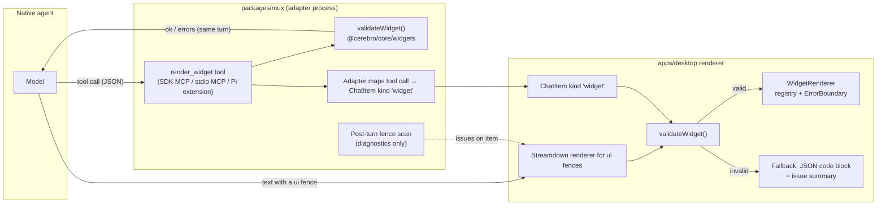
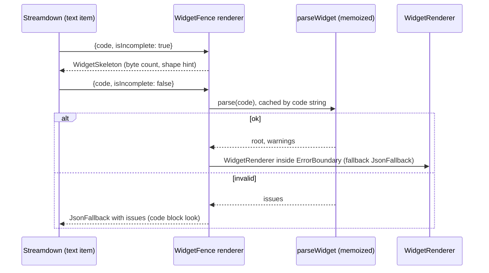

# Inline widgets in agent chat (generative UI)

Status: **design spec, not implemented.** Nothing in this document exists in the codebase yet. This document is for review.

Research comes from the current checkout:

- `packages/mux/src/agents/adapters/{claude,codex,pi,shared}.ts` and `codex-server.ts`
- `packages/core/src/chat.ts`
- `apps/desktop/src/renderer/src/components/{markdown,chat}/`
- `apps/desktop/src/renderer/index.html` (CSP)
- the installed `@anthropic-ai/claude-agent-sdk` 0.3.287 types (`sdk.d.ts`)
- the installed `streamdown` 2.7.0 types

External sources are pinned to commits and listed in [§22](#22-sources). Claims that could not be checked against source or docs are marked _unverified_.

## 1. Summary

An agent reply can include **widgets**: cards, tables, charts, status cards, lists, and later forms. Cerebro renders each widget with its own shadcn components (the Base UI flavor, `style: "base-vega"` in `apps/desktop/components.json`) and shadcn charts (Recharts v3).

- **Vocabulary.** The widget vocabulary is OpenAI ChatKit's widget types, used as a spec under Apache-2.0 with attribution. The types come from `openai/chatkit-js` (`packages/chatkit/types/widgets.d.ts`). `Chart` comes from `openai/chatkit-python` (`chatkit/widgets.py`). Cerebro extends the vocabulary with more components and animated charts. Every extension is marked as such.
- **No chatkit-js runtime.** Its runtime is a CDN script (`https://cdn.platform.openai.com/deployments/chatkit/chatkit.js`), and our CSP is `script-src 'self'`.

Widgets reach the transcript in two ways, and both are rendered by the same validator and registry:

1. **Tool path.** Where the harness lets Cerebro add a tool, a `render_widget` tool is available:
   - **Claude:** an in-process SDK MCP server.
   - **Codex:** a stdio MCP server injected through `thread/start` and `thread/resume` `config`. A spike evaluates experimental `dynamicTools`.
   - **Pi:** a bundled extension loaded with `-e`.

   The tool validates the payload and returns errors to the model in the same turn. Its call becomes a new `ChatItem` of kind `widget`.

2. **Fence path (universal fallback).** The agent writes a fenced ` ```ui ` block containing one widget JSON root. Streamdown routes the fence to a custom renderer:
   - a skeleton while the fence is open
   - the validated widget once it closes
   - a plain JSON code block if validation fails

One Zod schema in `@cerebro/core` defines the format, with an explicit `version`. The mux, the CLI validator, the Pi extension bundle, and the renderer all use it.

## 2. Goals and non-goals

### Goals

- G1. Agents in all three harnesses (Claude, Codex, Pi) can show structured results: tables, comparisons, charts, status, and lists. Cerebro renders them with its own design system, in the dark theme.
- G2. A large catalog, well beyond ChatKit's roughly 28 components, delivered in phases. It includes **animated charts** (bar, line, area, pie and donut, radar, radial and gauge, scatter, composed, funnel, treemap) and animated stats and progress. A reduced-motion preference is honored.
- G3. A strict, versioned JSON format that is safe by construction: no HTML, no scripts, no `eval`, no style injection, no remote fetches, and URLs and actions checked against allowlists.
- G4. Delivery that works when a harness allows no custom tool. The universal fallback is a fence. Validation errors still reach the model where the harness allows it.
- G5. Transcripts replay identically. Widgets persist in `session-<id>.json` and re-render the same way after restart, rewind, or fork, without replaying animations.
- G6. Failure is graceful. A bad widget never breaks the transcript; it falls back to a readable code block.

### Non-goals (v1)

- N1. Running ChatKit's JS engine or any remote script. CSP stays `script-src 'self'`.
- N2. Arbitrary HTML, CSS, or JS from the model. That includes MCP Apps and MCP-UI `ui://` iframe resources (see [§17](#17-alternatives-considered)).
- N3. Server-side widget actions in the ChatKit sense (`handler: "server"`). Every action is handled on the client by a fixed allowlist ([§11](#11-actions-and-security)).
- N4. Widgets that update after their turn ends (ChatKit `WidgetRootUpdated` and `WidgetComponentUpdated` streams). A widget is immutable once its turn completes. To show something new, the agent renders a new widget.
- N5. Vega-Lite in v1. It is an optional add-on ([§17](#17-alternatives-considered)).
- N6. Light theme. The app is dark-only (`<html class="dark">`, and Shiki uses `github-dark` for both slots). `ThemeColor.light` values are accepted and ignored.
- N7. Widgets from sub-agents. Child agent text is already kept off the transcript (`forwardSubagentText` stays false).

## 3. Background: how chat renders today

These facts constrain the design. They are verified in this checkout, and [`agent-stream-shapes.md`](agent-stream-shapes.md) has the full detail.

- **Snapshots, not deltas.** Adapters emit `AgentDelta` items. The service merges them into `session.items` by `${turnId}:${item.id}` and persists them to `session-<id>.json`. The renderer refetches the whole snapshot on every `chat.changed` notification and never replays deltas. React Query's default structural sharing keeps unchanged items referentially stable, so `memo(ChatItem)` skips them.
- **Item kinds.** `ChatItem.kind` is `'user' | 'text' | 'reasoning' | 'tool' | 'diff' | 'plan' | 'notice' | 'request'` (`packages/core/src/chat.ts`). `tool` and `reasoning` items are folded into the "Working" disclosure (`tool-groups.ts`), so a widget delivered as a plain `tool` item would be hidden there.
- **Markdown.** `AgentMarkdown` renders `text` items with Streamdown 2.7 (`mode="streaming"`). `markdownComponents.code` is `MarkdownCode`. It already special-cases `language-mermaid`: mermaid blocks pass through without the code-block chrome.
- **Custom fence renderers.** Streamdown 2.7 supports them natively through `plugins.renderers: [{ language, component }]`. The component receives `{ code, language, isIncomplete, meta }`. Streamdown's default `code` component looks the renderer up by language (verified in `dist/chunk-*.js`), and `MarkdownCode` delegates to that default. `useIsCodeFenceIncomplete()` is also exported.
- **CSP.** `default-src 'self'; script-src 'self'; style-src 'self' 'unsafe-inline'; img-src 'self' data: cerebro-media: https://avatars.githubusercontent.com; media-src 'self' cerebro-media:; font-src 'self'`.
- **Remote images.** `MarkdownImage` never fetches remote images ("a model-written URL can carry data out of the app"). Links open only `http(s)` URLs, through `window.cerebro.openExternal`.
- **Available packages.** `motion` ^14 is already a dependency. `recharts`, `zod`, and a virtualizer are **not** direct dependencies; zod 4.5.4 is present only transitively, through the Claude SDK.
- **Existing shadcn components.** `components/ui/` has avatar, badge, button, collapsible, dialog, dropdown-menu, input, label, popover, select, separator, sheet, sidebar, skeleton, tabs, and tooltip. No card, table, chart, or progress yet.

## 4. Architecture overview



New modules (names are proposals):

| Module                                                                          | Package         | Purpose                                                                                                                  |
| ------------------------------------------------------------------------------- | --------------- | ------------------------------------------------------------------------------------------------------------------------ |
| `packages/core/src/widgets/schema.ts`                                           | `@cerebro/core` | Zod schema, `WidgetEnvelope`, limits, `parseWidget()`, `formatIssues()`                                                  |
| `packages/core/src/widgets/text.ts`                                             | `@cerebro/core` | `widgetToText(root)`: a markdown rendering for copy, search, and screen readers                                          |
| `packages/core/src/widgets/prompt.ts`                                           | `@cerebro/core` | Agent instructions and tool description ([§10](#10-agent-instructions-prompt-and-skill-text)), versioned with the schema |
| `packages/mux/src/agents/widgets.ts`                                            | `@cerebro/mux`  | Tool handler, harness wiring helpers, post-turn fence scan                                                               |
| `apps/cli/src/commands/widget.ts`                                               | CLI             | `cerebro widget validate` and `cerebro widget mcp` (stdio MCP server)                                                    |
| `packages/mux/src/agents/pi-widgets-extension.ts` → bundled `.js` in `out/cli`  | build output    | Pi extension registering `render_widget`                                                                                 |
| `apps/desktop/src/renderer/src/components/widgets/`                             | desktop         | `WidgetRenderer`, registry, component implementations, fence renderer, skeleton, fallback                                |
| `apps/desktop/src/renderer/src/components/ui/{card,table,chart,progress,…}.tsx` | desktop         | New shadcn base-vega components (`pnpm dlx shadcn@latest add …`)                                                         |

## 5. Widget JSON format

### 5.1 Envelope and versioning

A widget payload is one JSON object. Its `type` is one of the root types `Card`, `ListView`, or `Basic`, which matches ChatKit's `WidgetRoot`. Cerebro adds one optional top-level field:

```json
{ "version": 1, "type": "Card", "children": [ ... ] }
```

- **The `version` field.** `version` is an integer. If it is omitted, the payload is treated as version 1. Models routinely omit it, and requiring it would turn a cosmetic slip into a fallback.
- **Additive changes do not bump the version.** New components, new optional props, and new enum members are additive.
- **Breaking changes bump it to `2`.** A breaking change renames or removes a prop or changes its meaning. The renderer keeps every version's parser forever, because transcripts persist; `parseWidget()` dispatches on `version`.
- **An unknown future version** (for example, a newer agent prompt replayed in an older app build) falls back to the JSON code block. The notice reads "Widget format v3 needs a newer Cerebro".
- **Recorded version.** The fence info string may carry the version (` ```ui v1 `); the meta string is available as `CustomRendererProps.meta`. The body's `version` wins. Tool-path widget items record the version they were validated against in `ChatItem.widget.version`.

### 5.2 Validation policy

LLM output is noisy, so the parser is strict where safety matters and tolerant where it doesn't:

| Situation                                                                                      | Behavior                                                                                                       |
| ---------------------------------------------------------------------------------------------- | -------------------------------------------------------------------------------------------------------------- |
| Not valid JSON                                                                                 | Fatal: fallback                                                                                                |
| Root `type` not a root type                                                                    | If it is a valid component, wrap it in `{ type: "Basic", children: [it] }` (warning). Otherwise fatal.         |
| Unknown **prop** on a known component                                                          | Stripped, with a warning. Zod object schemas use the default `strip` behavior, not `strict`.                   |
| Unknown component `type` in a subtree                                                          | That node becomes an inline `UnsupportedNode` chip ("Unsupported: Foo") (warning). The rest renders.           |
| Invalid prop value (wrong enum, wrong type)                                                    | The node gets an inline error chip (warning), unless the prop is security-relevant                             |
| Security-relevant violation (URL scheme, color syntax, action type, `data:` MIME, size limits) | That value is dropped or the node is replaced. Never coerced into something renderable. The issue is reported. |
| Limits exceeded ([§5.5](#55-limits))                                                           | Fatal for payload-size and depth limits. Truncation with a visible notice for row and point limits.            |

"Warning" issues are collected and shown in the widget's overflow menu ("2 issues"). On the tool path they are also returned to the model as a non-error note, so it can fix them next time. On the tool path, **any** issue is reported, but only fatal issues produce `isError: true`.

### 5.3 Zod schema (abridged)

Zod 4 becomes a direct dependency of `@cerebro/core`, pinned to the 4.x line the Claude SDK already uses (4.5.4 in the lockfile). Recursion uses Zod 4 getters. Only representative components are shown; the full schema follows the catalog in [§6](#6-component-catalog) one to one.

```ts
// packages/core/src/widgets/schema.ts
// Widget vocabulary adapted from OpenAI ChatKit (Apache-2.0):
//   openai/chatkit-js packages/chatkit/types/widgets.d.ts
//   openai/chatkit-python chatkit/widgets.py (Chart)
// Cerebro extensions are marked `// ext`.
import { z } from 'zod'

// ---------- primitives ----------
const Size = z.union([z.number().min(0).max(4000), z.string().regex(/^\d+(\.\d+)?(px|%|rem)$/)])
// Colors: chart/semantic tokens, Tailwind palette tokens, or literal hex/oklch/rgb/hsl. Never url(), var(), or expressions.
const ColorToken = z.enum([
  'blue',
  'purple',
  'orange',
  'green',
  'red',
  'yellow',
  'pink',
  'gray',
  'teal',
  'cyan'
])
const SemanticColor = z.enum([
  'primary',
  'secondary',
  'muted',
  'success',
  'warning',
  'danger',
  'info',
  'discovery',
  'caution'
])
const PaletteToken = z
  .string()
  .regex(
    /^(slate|gray|zinc|neutral|red|orange|amber|yellow|lime|green|emerald|teal|cyan|sky|blue|indigo|violet|purple|fuchsia|pink|rose)-(50|[1-9]00|950)$/
  )
const LiteralColor = z
  .string()
  .regex(/^(#[0-9a-f]{3,8}|(oklch|rgb|rgba|hsl|hsla)\([0-9.,%\s/-]{1,60}\))$/i)
const Color = z.union([ColorToken, SemanticColor, PaletteToken, LiteralColor])
const ThemeColor = z.union([Color, z.object({ dark: Color, light: Color.optional() })])
const Spacing = z.union([
  Size,
  z.object({ top: Size, right: Size, bottom: Size, left: Size, x: Size, y: Size }).partial()
])
const Align = z.enum(['start', 'center', 'end', 'baseline', 'stretch'])
const Justify = z.enum(['start', 'center', 'end', 'between', 'around', 'evenly', 'stretch'])
const IconName = z.string().max(40) // mapped to lucide; unknown → 'dot' (warning)

// ---------- actions ----------
export const Action = z.discriminatedUnion('type', [
  z.object({
    type: z.literal('send_message'),
    payload: z.object({ text: z.string().min(1).max(4000) })
  }),
  z.object({
    type: z.literal('copy'),
    payload: z.object({ text: z.string().min(1).max(100_000) })
  }),
  z.object({ type: z.literal('open_url'), payload: z.object({ url: z.string().max(2048) }) }), // further checked by safeUrl()
  z.object({
    type: z.literal('open_file'),
    payload: z.object({ path: z.string().max(1024), line: z.number().int().min(1).optional() })
  }), // ext, phase 2
  z.object({
    type: z.literal('submit_form'),
    payload: z.object({ intent: z.string().max(200).optional() }).optional()
  }) // ext, phase 3
])

// ---------- animation (ext) ----------
const Easing = z.enum(['ease', 'ease-in', 'ease-out', 'ease-in-out', 'linear', 'spring'])
export const Animation = z.union([
  z.boolean(),
  z.object({
    duration: z.number().int().min(0).max(2000).optional(), // ms, clamped
    delay: z.number().int().min(0).max(1500).optional(),
    easing: Easing.optional(),
    stagger: z.number().int().min(0).max(300).optional() // ms between series/items
  })
])

// ---------- components ----------
const base = { key: z.string().max(100).optional(), id: z.string().max(100).optional() }

export const Text = z.object({
  ...base,
  type: z.literal('Text'),
  value: z.string().max(20_000),
  size: z.enum(['xs', 'sm', 'md', 'lg', 'xl']).optional(),
  weight: z.enum(['normal', 'medium', 'semibold', 'bold']).optional(),
  color: ThemeColor.optional(),
  italic: z.boolean().optional(),
  lineThrough: z.boolean().optional(),
  textAlign: z.enum(['start', 'center', 'end']).optional(),
  truncate: z.boolean().optional(),
  maxLines: z.number().int().min(1).max(50).optional()
})

const SeriesBase = {
  label: z.string().max(80).optional(),
  dataKey: z.string().max(80),
  color: ThemeColor.optional()
}
const Curve = z.enum([
  'basis',
  'basisClosed',
  'basisOpen',
  'bumpX',
  'bumpY',
  'bump',
  'linear',
  'linearClosed',
  'natural',
  'monotoneX',
  'monotoneY',
  'monotone',
  'step',
  'stepBefore',
  'stepAfter'
])
const ValueFormat = z
  .string()
  .regex(/^(number|compact|percent|bytes|duration-ms|duration-s|currency:[A-Z]{3})(\.\d)?$/) // ext; never a function
export const Chart = z.object({
  ...base,
  type: z.literal('Chart'),
  data: z
    .array(z.record(z.string().max(80), z.union([z.string().max(200), z.number(), z.null()])))
    .max(5000),
  series: z
    .array(
      z.discriminatedUnion('type', [
        z.object({
          type: z.literal('bar'),
          ...SeriesBase,
          stack: z.string().max(40).optional(),
          radius: z.number().min(0).max(16).optional() /* ext */
        }),
        z.object({
          type: z.literal('area'),
          ...SeriesBase,
          stack: z.string().max(40).optional(),
          curveType: Curve.optional(),
          gradient: z.boolean().optional() /* ext */
        }),
        z.object({
          type: z.literal('line'),
          ...SeriesBase,
          curveType: Curve.optional(),
          dots: z.boolean().optional() /* ext */,
          dashed: z.boolean().optional() /* ext */
        })
      ])
    )
    .min(1)
    .max(12),
  xAxis: z.union([
    z.string(),
    z.object({
      dataKey: z.string(),
      hide: z.boolean().optional(),
      labels: z.record(z.string(), z.string()).optional()
    })
  ]),
  showYAxis: z.boolean().optional(),
  showLegend: z.boolean().optional(),
  showTooltip: z.boolean().optional(),
  barGap: z.number().optional(),
  barCategoryGap: z.number().optional(),
  height: Size.optional(),
  aspectRatio: z.union([z.number(), z.string()]).optional(),
  // ext
  layout: z.enum(['horizontal', 'vertical']).optional(),
  showGrid: z.boolean().optional(),
  yAxis: z
    .object({
      format: ValueFormat.optional(),
      domain: z
        .tuple([z.union([z.number(), z.literal('auto')]), z.union([z.number(), z.literal('auto')])])
        .optional(),
      label: z.string().max(60).optional()
    })
    .optional(),
  referenceLines: z
    .array(
      z.object({
        y: z.number().optional(),
        x: z.union([z.string(), z.number()]).optional(),
        label: z.string().max(40).optional(),
        color: ThemeColor.optional()
      })
    )
    .max(5)
    .optional(),
  animate: Animation.optional(),
  summary: z.string().max(500).optional() // screen-reader summary; generated if absent
})

// Recursive union via getters (Zod 4).
export const Component: z.ZodType<WidgetComponent> = z.lazy(() =>
  z.discriminatedUnion('type', [
    Text,
    Title,
    Caption,
    Markdown,
    Badge,
    Icon,
    Image,
    Divider,
    Spacer,
    Button,
    Box,
    Row,
    Col,
    Form,
    Transition,
    Table,
    Chart,
    ListViewItem,
    // ext, phase 1–3
    Label,
    Stat,
    Progress,
    Meter,
    Alert,
    KeyValue,
    DataTable,
    CodeBlock,
    Kbd,
    Avatar,
    Spinner,
    Empty,
    PieChart,
    RadarChart,
    RadialChart,
    ScatterChart,
    Sparkline,
    Timeline,
    Steps,
    Tabs,
    Accordion,
    Collapsible,
    FileRef,
    Diff,
    HoverCard,
    ScrollArea,
    Grid,
    Input,
    Textarea,
    Select,
    Checkbox,
    RadioGroup,
    DatePicker,
    Switch,
    Slider,
    ToggleGroup,
    ComposedChart,
    FunnelChart,
    Treemap,
    Heatmap
  ])
)

export const Card = z.object({
  ...base,
  type: z.literal('Card'),
  get children() {
    return z.array(Component).max(200)
  },
  size: z.enum(['sm', 'md', 'lg', 'full']).optional(),
  padding: Spacing.optional(),
  background: ThemeColor.optional(),
  status: z
    .union([
      z.object({ text: z.string().max(120), icon: IconName.optional() }),
      z.object({
        text: z.string().max(120),
        favicon: z.string().optional(),
        frame: z.boolean().optional()
      })
    ])
    .optional(),
  collapsed: z.boolean().optional(),
  asForm: z.boolean().optional(),
  confirm: z.object({ label: z.string().max(40), action: Action }).optional(),
  cancel: z.object({ label: z.string().max(40), action: Action }).optional(),
  theme: z.enum(['light', 'dark']).optional() // accepted, ignored (dark-only app)
})

export const WidgetRoot = z.discriminatedUnion('type', [Card, ListView, BasicRoot])
export const WidgetEnvelope = WidgetRoot.and(z.object({ version: z.literal(1).optional() }))
export type WidgetRoot = z.infer<typeof WidgetRoot>
```

Notes:

- **`favicon`.** `Card.status.favicon` (from ChatKit) is a remote URL, so it is never fetched. It renders as a globe icon and keeps the `text`.
- **`ListViewItem`** is valid only as a direct child of `ListView`, as in ChatKit. Elsewhere it is unwrapped into a `Row` (warning).
- **JSON Schema export.** `z.toJSONSchema(WidgetEnvelope)` produces a JSON Schema for docs and tests. It is **not** used as the tool input schema ([§8.5](#85-tool-input-schema)).

### 5.4 Normalized shape stored on a widget item

```ts
// packages/core/src/chat.ts (additions)
type ChatItem = {
  // ...existing fields
  kind: 'user' | 'text' | 'reasoning' | 'tool' | 'diff' | 'plan' | 'notice' | 'request' | 'widget'
  widget?: {
    version: number // schema version the payload was validated against
    root: unknown // the payload as the model sent it (after JSON.parse), re-validated at render
    source: 'tool' | 'fence' // fence widgets live in `text` items; this is for tool items only in v1
    tool?: string // native tool name, e.g. mcp__cerebro__render_widget
    issues?: WidgetIssue[] // from mux-side validation; renderer recomputes
    title?: string // short label for the tool line, search, and notifications
  }
}
type WidgetIssue = { path: string; message: string; severity: 'error' | 'warning' }
```

Storing the raw payload instead of the normalized one keeps replay faithful. A newer renderer with a fixed validator can render widgets that an older build rejected. `text` holds `widgetToText(root)`, so copy-turn (`chat-turns.ts`), search indexing (`search-index.ts`), and notifications keep working with no special case.

### 5.5 Limits

These limits bound memory, parse time, and render time. They are enforced in `parseWidget()`, and the same numbers appear in the agent instructions.

| Limit                                      | Value                        | On exceed                                                        |
| ------------------------------------------ | ---------------------------- | ---------------------------------------------------------------- |
| Serialized payload                         | 256 KB                       | Fatal                                                            |
| Nesting depth                              | 16                           | Fatal                                                            |
| Total nodes                                | 1,500                        | Fatal                                                            |
| `Table` rows / `DataTable` rows            | 200 / 5,000                  | Truncated, with a "Showing first N of M" footer                  |
| Chart data points (rows × series)          | 10,000; max 12 series        | Downsampled (LTTB for line and area, top-N plus "Other" for pie) |
| Charts per widget                          | 12                           | The rest render as "Chart omitted"                               |
| `data:` image                              | 1 MB, png/jpeg/gif/webp only | Dropped                                                          |
| Widgets per assistant message (fence path) | 8                            | The rest render as code blocks                                   |

## 6. Component catalog

ChatKit defines about 28 widget types (`widgets.d.ts` plus `Chart`). The catalog below has **63** components (34 + 15 + 10 + 4), delivered in four phases. Where a component maps cleanly, it is implemented with an existing or newly added shadcn base-vega component. The availability of each added shadcn component was checked against the registry (`https://ui.shadcn.com/r/styles/base-vega/<name>.json` returned 200 for card, table, chart, progress, accordion, alert, slider, switch, radio-group, checkbox, textarea, toggle-group, kbd, spinner, empty, item, field, calendar, hover-card, and scroll-area).

Legend for the origin column:

- **CK**: ChatKit (chatkit-js types)
- **CK-py**: chatkit-python only
- **ext**: Cerebro extension

The animation column lists what animates when motion is allowed ([§7.3](#73-reduced-motion)).

### Phase 1: display primitives, tables, cartesian charts (34 components, plus one internal node)

| Component         | Origin   | Key props (beyond `key`, `id`)                                                                                                                                                                       | Implementation                                                               | Animation                                                               |
| ----------------- | -------- | ---------------------------------------------------------------------------------------------------------------------------------------------------------------------------------------------------- | ---------------------------------------------------------------------------- | ----------------------------------------------------------------------- |
| `Card`            | CK       | `children`, `size`, `padding`, `background`, `status`, `collapsed`, `confirm`, `cancel`, `asForm`                                                                                                    | shadcn `card` (new)                                                          | Fade and rise on first mount (motion, 180 ms)                           |
| `ListView`        | CK       | `children: ListViewItem[]`, `limit` (`number \| 'auto'`), `status`                                                                                                                                   | `item` group (new)                                                           | Item stagger, 30 ms                                                     |
| `ListViewItem`    | CK       | `children`, `onClickAction`, `gap`, `align`                                                                                                                                                          | `item` (new); a button when an action is set                                 | (none)                                                                  |
| `Basic`           | CK       | `children`, `direction`, `gap`, `padding`, `align`, `justify`                                                                                                                                        | `div` flex                                                                   | (none)                                                                  |
| `Box`             | CK       | `direction`, `align`, `justify`, `wrap`, `flex`, `gap`, `padding`, `border`, `background`, sizing (`BlockProps`)                                                                                     | `div` flex with validated inline style                                       | (none)                                                                  |
| `Row`             | CK       | as `Box`, row                                                                                                                                                                                        | `div` flex-row                                                               | (none)                                                                  |
| `Col`             | CK       | as `Box`, column                                                                                                                                                                                     | `div` flex-col                                                               | (none)                                                                  |
| `Spacer`          | CK       | `minSize`                                                                                                                                                                                            | `div` flex-1                                                                 | (none)                                                                  |
| `Divider`         | CK       | `color`, `size`, `spacing`, `flush`                                                                                                                                                                  | shadcn `separator`                                                           | (none)                                                                  |
| `Transition`      | CK       | `children` (single)                                                                                                                                                                                  | `motion` `AnimatePresence` + `layout`                                        | Layout and crossfade (phase 1: mount only, since widgets are immutable) |
| `Text`            | CK       | `value`, `size`, `weight`, `color`, `italic`, `lineThrough`, `textAlign`, `truncate`, `maxLines`, `streaming`                                                                                        | `p`/`span`                                                                   | (none); `streaming` is ignored (N4)                                     |
| `Title`           | CK       | `value`, `size` (`sm`…`5xl`), `weight`, `color`, `textAlign`, `truncate`, `maxLines`                                                                                                                 | `h3` (level from depth)                                                      | (none)                                                                  |
| `Caption`         | CK       | `value`, `size`, `weight`, `color`, `textAlign`, `truncate`, `maxLines`                                                                                                                              | `p.text-muted-foreground`                                                    | (none)                                                                  |
| `Markdown`        | CK       | `value`                                                                                                                                                                                              | `AgentMarkdown` with `ui` fences disabled (no recursion)                     | (none)                                                                  |
| `Badge`           | CK       | `label`, `color`, `variant` (`solid\|soft\|outline`), `size`, `pill`                                                                                                                                 | shadcn `badge`                                                               | (none)                                                                  |
| `Icon`            | CK       | `name` (ChatKit `WidgetIcon` → lucide map), `color`, `size`                                                                                                                                          | lucide-react                                                                 | (none)                                                                  |
| `Image`           | CK       | `src`, `alt`, `fit`, `position`, `frame`, `flush`, sizing                                                                                                                                            | Reuses `MarkdownImage` (local file or `data:`; remote becomes a placeholder) | (none)                                                                  |
| `Button`          | CK       | `label`, `onClickAction`, `iconStart`, `iconEnd`, `style`, `color`, `variant`, `size`, `pill`, `block`, `uniform`, `submit`                                                                          | shadcn `button`                                                              | Press feedback only (CSS)                                               |
| `Table`           | CK       | `children: Table.Row[]`                                                                                                                                                                              | shadcn `table` (new)                                                         | (none)                                                                  |
| `Table.Row`       | CK       | `children: Table.Cell[]`, `header`                                                                                                                                                                   | `tr` / `thead > tr`                                                          | (none)                                                                  |
| `Table.Cell`      | CK       | `children`, `width`, `padding`, `colSpan`, `rowSpan`, `align`, `vAlign`, `colSize`                                                                                                                   | `td` / `th scope="col"`                                                      | (none)                                                                  |
| `Chart`           | CK-py    | `data`, `series[bar\|line\|area]`, `xAxis`, `showYAxis`, `showLegend`, `showTooltip`, `barGap`, `barCategoryGap`, sizing; ext: `layout`, `showGrid`, `yAxis`, `referenceLines`, `animate`, `summary` | shadcn `chart` + Recharts `ComposedChart`                                    | Series entrance ([§7](#7-charts-and-animation))                         |
| `Label`           | CK       | `value`, `fieldName`, `size`, `weight`, `textAlign`, `color`                                                                                                                                         | shadcn `label`                                                               | (none)                                                                  |
| `Stat`            | ext      | `label`, `value` (number), `format` (`ValueFormat`), `delta` {`value`, `format`, `direction`: `up\|down\|flat`, `good`: `up\|down`}, `caption`, `icon`                                               | Card-less block                                                              | Count-up of `value` (motion `animate`, 600 ms); delta fades in after    |
| `Progress`        | ext      | `value` (0–100), `label`, `color`, `showValue`, `indeterminate`                                                                                                                                      | shadcn `progress` (new)                                                      | Fill from 0 (CSS transition, 500 ms)                                    |
| `Meter`           | ext      | `value`, `min`, `max`, `thresholds` [{`at`, `color`}], `label`                                                                                                                                       | `progress` + `role="meter"`                                                  | Fill (as `Progress`)                                                    |
| `Alert`           | ext      | `variant` (`info\|success\|warning\|danger`), `title`, `description`, `icon`                                                                                                                         | shadcn `alert` (new)                                                         | (none)                                                                  |
| `KeyValue`        | ext      | `items` [{`label`, `value`, `copy`?}], `columns` (1–3)                                                                                                                                               | `dl` grid                                                                    | (none)                                                                  |
| `DataTable`       | ext      | `columns` [{`key`, `label`, `format`, `align`, `width`}], `rows` (objects), `sortable`, `defaultSort`, `caption`, `maxHeight`, `striped`                                                             | shadcn `table` + sorting + virtualization ([§15](#15-performance))           | (none)                                                                  |
| `CodeBlock`       | ext      | `code`, `language`, `filename`                                                                                                                                                                       | Existing `MarkdownCode` path (Shiki via `@streamdown/code`)                  | (none)                                                                  |
| `Kbd`             | ext      | `keys: string[]`                                                                                                                                                                                     | shadcn `kbd` (new)                                                           | (none)                                                                  |
| `Avatar`          | ext      | `name`, `src` (local or `data:` only), `size`                                                                                                                                                        | shadcn `avatar`                                                              | (none)                                                                  |
| `Spinner`         | ext      | `label`                                                                                                                                                                                              | shadcn `spinner` (new)                                                       | Spin; static under reduced motion                                       |
| `Empty`           | ext      | `title`, `description`, `icon`                                                                                                                                                                       | shadcn `empty` (new)                                                         | (none)                                                                  |
| `UnsupportedNode` | internal | (renderer only)                                                                                                                                                                                      | Inline chip                                                                  | (none)                                                                  |

### Phase 2: more animated charts and richer layout (15 components, plus `Stat.trend`)

| Component        | Origin | Key props                                                                                                                                                         | Recharts / shadcn                                       | Animation                                                                                                     |
| ---------------- | ------ | ----------------------------------------------------------------------------------------------------------------------------------------------------------------- | ------------------------------------------------------- | ------------------------------------------------------------------------------------------------------------- |
| `PieChart`       | ext    | `data` [{`name`, `value`, `color`?}], `variant` (`pie\|donut`), `innerRadius`, `centerLabel` {`value`, `label`}, `showLabels`, `showLegend`, `animate`, `summary` | `PieChart` + `Pie` + `Label`                            | Sweep-in arc. Recharts default: begin 400 ms, duration 1500 ms. Cerebro default: begin 0, 900 ms, `ease-out`. |
| `RadarChart`     | ext    | `data`, `angleKey`, `series` [{`dataKey`, `label`, `color`, `fillOpacity`}], `showGrid`, `animate`                                                                | `RadarChart` + `PolarGrid` + `PolarAngleAxis` + `Radar` | Grow from center (default 1500 ms → Cerebro 800 ms)                                                           |
| `RadialChart`    | ext    | `data` [{`name`, `value`, `color`?}], `max`, `startAngle`, `endAngle`, `variant` (`bars\|gauge`), `centerLabel`, `animate`                                        | `RadialBarChart` + `RadialBar` + `PolarAngleAxis`       | Bars sweep from `startAngle` (default 1500 ms → 900 ms)                                                       |
| `ScatterChart`   | ext    | `data`, `x` {`dataKey`, `label`, `format`}, `y` {…}, `z`? (bubble size), `series` [{`label`, `filter`?: {`key`, `equals`}, `color`}], `animate`                   | `ScatterChart` + `Scatter` + `ZAxis`                    | Points fade and scale (default 400 ms, `linear`)                                                              |
| `Sparkline`      | ext    | `data: number[]` (≤ 200), `variant` (`line\|area\|bar`), `color`, `height`                                                                                        | `LineChart`/`AreaChart` with no axes                    | Draw-in (600 ms)                                                                                              |
| `Stat` + `trend` | ext    | `Stat.trend: number[]`: an inline `Sparkline` under the value                                                                                                     | (as `Sparkline`)                                        | (as `Sparkline`)                                                                                              |
| `Timeline`       | ext    | `items` [{`title`, `time`, `description`, `status` (`done\|current\|pending\|failed`), `icon`}]                                                                   | `ol` with connector                                     | Stagger (40 ms)                                                                                               |
| `Steps`          | ext    | `steps` [{`label`, `status`}], `orientation`                                                                                                                      | `ol`                                                    | Current-step pulse (static under reduced motion)                                                              |
| `Tabs`           | ext    | `tabs` [{`label`, `children`}], `defaultIndex`                                                                                                                    | shadcn `tabs`                                           | Indicator slide (existing tabs CSS)                                                                           |
| `Accordion`      | ext    | `items` [{`title`, `children`, `open`?}], `multiple`                                                                                                              | shadcn `accordion` (new)                                | Height expand (Base UI, `motion-reduce:transition-none`)                                                      |
| `Collapsible`    | ext    | `title`, `children`, `open`                                                                                                                                       | shadcn `collapsible`                                    | (as `Accordion`)                                                                                              |
| `FileRef`        | ext    | `path`, `line`?, `label`?: a workspace file chip; click → `open_file`                                                                                             | Existing file-icon helpers (`file-icon.ts`)             | (none)                                                                                                        |
| `Diff`           | ext    | `patch` (unified diff, ≤ 200 KB), `path`                                                                                                                          | Existing `chat-diff.tsx` renderer                       | (none)                                                                                                        |
| `HoverCard`      | ext    | `trigger` (Text/Badge), `children`                                                                                                                                | shadcn `hover-card` (new)                               | Fade (Base UI)                                                                                                |
| `ScrollArea`     | ext    | `maxHeight`, `children`                                                                                                                                           | shadcn `scroll-area` (new)                              | (none)                                                                                                        |
| `Grid`           | ext    | `columns` (1–6 or `auto-fit` min width), `gap`, `children`                                                                                                        | CSS grid                                                | Child stagger (30 ms)                                                                                         |

### Phase 3: forms and interaction (10 components, plus card and list actions)

All of these are **CK** except `Switch`, `Slider`, and `ToggleGroup`, which are **ext**. ChatKit's `Form`, `Input`, `Textarea`, `Select`, `Checkbox`, `RadioGroup`, and `DatePicker` keep their prop names (`name`, `defaultValue`, `required`, `pattern`, `placeholder`, `options`, `onChangeAction`, and so on). Form controls are uncontrolled. Submitting reads `FormData` from the nearest `Form` (or a `Card` with `asForm: true`) and sends it as a user turn ([§11.2](#112-allowlisted-actions)).

| Component                      | Implementation                                                      | Notes                                                                                                                                                                                                     |
| ------------------------------ | ------------------------------------------------------------------- | --------------------------------------------------------------------------------------------------------------------------------------------------------------------------------------------------------- |
| `Form`                         | `form`                                                              | `onSubmitAction` must be `submit_form` or `send_message`. **The submit button is never disabled** (repo rule in AGENTS.md). Invalid input shows inline errors; an in-flight flag ignores a second submit. |
| `Input`                        | shadcn `input`                                                      | `inputType`: `text\|number\|email\|url\|tel`. `password` maps to `text`, because widget form values become a visible user turn.                                                                           |
| `Textarea`                     | shadcn `textarea` (new)                                             | `rows`, `autoResize`, `maxRows`                                                                                                                                                                           |
| `Select`                       | shadcn `select`                                                     | `onChangeAction` is ignored in v1: changes only matter on submit (open question Q6)                                                                                                                       |
| `Checkbox`                     | shadcn `checkbox` (new)                                             | (none)                                                                                                                                                                                                    |
| `RadioGroup`                   | shadcn `radio-group` (new)                                          | (none)                                                                                                                                                                                                    |
| `DatePicker`                   | shadcn `calendar` + `popover` (adds `react-day-picker`, `date-fns`) | `min`/`max` ISO strings                                                                                                                                                                                   |
| `Switch` (ext)                 | shadcn `switch` (new)                                               | (none)                                                                                                                                                                                                    |
| `Slider` (ext)                 | shadcn `slider` (new)                                               | `min`, `max`, `step`, `defaultValue`                                                                                                                                                                      |
| `ToggleGroup` (ext)            | shadcn `toggle-group` (new)                                         | Single or multiple choice                                                                                                                                                                                 |
| `Card.confirm` / `Card.cancel` | Footer buttons                                                      | Actions are the same allowlist as for `Button`                                                                                                                                                            |
| `ListViewItem.onClickAction`   | Row as a button                                                     | (already parsed in phase 1, enabled in phase 3)                                                                                                                                                           |

### Phase 4: advanced charts (4 components, optional and demand-driven)

| Component       | Recharts                                                                       | Animation                                                 |
| --------------- | ------------------------------------------------------------------------------ | --------------------------------------------------------- |
| `ComposedChart` | Bars, lines, and areas on one axis, with an optional second Y axis (`yAxisId`) | As for each series type                                   |
| `FunnelChart`   | `FunnelChart` + `Funnel` + `LabelList`                                         | Trapezoid grow (default begin 400 ms, 1500 ms → 900 ms)   |
| `Treemap`       | `Treemap`                                                                      | Tile grow (default 1500 ms, `linear` → 700 ms `ease-out`) |
| `Heatmap`       | CSS grid of cells, not Recharts                                                | Cell fade stagger, capped at 400 ms total                 |

All animation defaults in the four phase tables are verified against the Recharts 3.11.1 type declarations (`defaultProps` blocks in `types/cartesian/*.d.ts`, `types/polar/*.d.ts`, `types/chart/Treemap.d.ts`).

### 6.1 Icon mapping

ChatKit's `WidgetIcon` names are mapped to lucide icons in one table, `components/widgets/icons.ts`. Examples:

- `check-circle` → `CircleCheck`
- `chart` → `ChartColumn`
- `bug` → `Bug`
- `sparkle` → `Sparkles`
- `external-link` → `ExternalLink`

Cerebro accepts any lucide icon name in kebab-case from a **static allowlist** of about 150 names. It never accepts a dynamic `lucide-react` lookup, so unused icons are not bundled. An unknown name renders `Dot` (warning).

## 7. Charts and animation

### 7.1 Stack

- **Charting library.** shadcn `chart` (base-vega) on Recharts v3. The registry entry pins `recharts@3.8.0`. Cerebro pins `recharts@^3.11` instead, because `animationMatchBy` (used for streaming and append-only data) was added in 3.9 per its JSDoc. shadcn says it does not wrap Recharts, so its components work on any 3.x.
- **Chart config.** `ChartContainer` sets `--color-<key>` variables through a `<style>` element (`dangerouslySetInnerHTML` in the registry source). It is allowed under `style-src 'unsafe-inline'`. Its input is built **only** from validated color tokens ([§12](#12-theming)), never from raw model strings.
- **Accessibility layer.** Recharts `accessibilityLayer` is on for every chart ([§13](#13-accessibility)).
- **Lazy loading.** Recharts is loaded lazily (`React.lazy(() => import('./charts'))`). It ships as a same-origin chunk, so `script-src 'self'` still holds.

### 7.2 Animation model

Recharts series components (Bar, Line, Area, Pie, Radar, RadialBar, Scatter, Funnel, Treemap) share the same props. Defaults below are verified in the 3.11.1 type declarations:

| Prop                | Type                                                                                                    | Recharts default                                                                                 |
| ------------------- | ------------------------------------------------------------------------------------------------------- | ------------------------------------------------------------------------------------------------ |
| `isAnimationActive` | `boolean \| 'auto'`                                                                                     | `'auto'`: "disabled in SSR and will respect the user's prefers-reduced-motion system preference" |
| `animationBegin`    | ms                                                                                                      | 0. Pie and Funnel use 400.                                                                       |
| `animationDuration` | ms                                                                                                      | Bar and Scatter: 400. Line, Area, Pie, Radar, RadialBar, Funnel, Treemap: 1500.                  |
| `animationEasing`   | `'ease' \| 'ease-in' \| 'ease-out' \| 'ease-in-out' \| 'linear' \| cubic-bezier(...) \| 'spring' \| fn` | `'ease'` (Scatter and Treemap: `'linear'`)                                                       |
| `animationMatchBy`  | `'index' \| 'append' \| …` (since 3.9)                                                                  | Line, Area, Radar: `index`. Others: `append`.                                                    |
| `onAnimationEnd`    | callback                                                                                                | (none)                                                                                           |

How Cerebro applies them:

- **Shorter defaults.** A 1.5 s line draw is slow in a chat stream. Cerebro uses bar 500 ms, line and area 800 ms, polar 900 ms, and `ease-out`. The widget's `animate` object can override them within the schema clamps (duration ≤ 2000 ms, delay ≤ 1500 ms).
- **Stagger.** Series `i` gets `animationBegin = delay + i * stagger`, with a 120 ms default and a total of at most 1200 ms.
- **`animate: false`** sets `isAnimationActive={false}`.
- **Large data.** Above 500 points per series, Cerebro forces `isAnimationActive={false}`. The interpolation cost is per frame.
- **Animate once per widget instance.** Animation runs only when the widget first becomes visible (`IntersectionObserver`, threshold 0.25) **and** the item is _fresh_, meaning it streamed in during this renderer session. Historic items loaded from disk, remounts after scroll, rewind/undo, and fork render final frames immediately. A module-level `Set<string>` of `${itemId}:${widgetKey}` records widgets that have already animated. Without it, every snapshot refetch or virtualization remount would replay the animation.
- **Non-chart motion** uses `motion` (already a dependency):
  - `Stat` count-up uses `animate(0, value, { duration: 0.6, ease: 'easeOut' })` rendered through the `ValueFormat` formatter.
  - `Card` entrance is a 180 ms fade and 4 px rise.
  - List and grid children stagger by 30 ms, capped at 10 animated children.
  - `Progress` and `Meter` fill with a CSS `transition-[width]`.
  - `Transition` uses `AnimatePresence`.

### 7.3 Reduced motion

A new setting, **Settings → Appearance → Animations in agent widgets**, has three values: `System` (default), `On`, and `Off`. It resolves to one boolean, `reduceMotion`, which is passed through a `WidgetMotionContext`:

- `System` follows `matchMedia('(prefers-reduced-motion: reduce)')`, subscribed to changes. The pattern already exists in `chat-view.tsx` and `content-tab-bar.tsx`.
- Recharts gets `isAnimationActive={!reduceMotion && fresh && allowedBySize}`. Cerebro does not rely on `'auto'`, because the explicit setting must override the OS in both directions.
- The widget subtree is wrapped in `<MotionConfig reducedMotion={reduceMotion ? 'always' : 'never'}>`.
- CSS animations (spinner, step pulse, accordion) use Tailwind `motion-reduce:` variants as well as a `data-reduce-motion` attribute on the widget root, for the `Off`-while-OS-allows case.
- With reduced motion, `Stat` shows the final value immediately, and `Spinner` shows a static icon with "Loading…" text.

### 7.4 Chart-specific rules

- **Colors.** Series colors default to `--chart-1` through `--chart-8` in order. ChatKit color tokens map to named chart variables ([§12](#12-theming)).
- **Value formats.** `ValueFormat` strings map to fixed `Intl.NumberFormat` formatters, for example `currency:USD.1` (USD with one fraction digit), `compact`, `percent`, `bytes`, and `duration-ms`. There are no user-supplied format functions.
- **Missing data.** `null` values render as gaps (`connectNulls={false}`). Non-numeric values for a numeric `dataKey` are treated as `null` (warning).
- **Size.** Height defaults to 220 px; `aspectRatio` overrides it. `ChartContainer` always gets a definite height or `aspect-*`, as the shadcn v3 upgrade notes require.

## 8. Delivery per harness

This section answers: _how does a widget get from the model to Cerebro when we may or may not be able to add a tool?_ Each option is backed by code in this checkout or by upstream source or docs.

### 8.1 Option matrix

| Option                                            | Claude (`claude-agent-sdk` `query()`)                                                                                                                                                                                                                                                                                                                                                     | Codex (`codex app-server`)                                                                                                                                                                                                                                                                                                                                                                                                                                                                                                                                                       | Pi (`pi --mode rpc`)                                                                                                                                                                                                                                                                                                              |
| ------------------------------------------------- | ----------------------------------------------------------------------------------------------------------------------------------------------------------------------------------------------------------------------------------------------------------------------------------------------------------------------------------------------------------------------------------------- | -------------------------------------------------------------------------------------------------------------------------------------------------------------------------------------------------------------------------------------------------------------------------------------------------------------------------------------------------------------------------------------------------------------------------------------------------------------------------------------------------------------------------------------------------------------------------------- | --------------------------------------------------------------------------------------------------------------------------------------------------------------------------------------------------------------------------------------------------------------------------------------------------------------------------------- |
| **In-process tool** (runs inside the mux)         | **Yes.** `createSdkMcpServer({ name, tools })` + `tool(name, description, zodShape, handler)`, passed as `options.mcpServers.cerebro` (`type: 'sdk'`). Verified in `sdk.d.ts` 0.3.287 (`createSdkMcpServer`, `McpSdkServerConfigWithInstance`, `tool()` with `alwaysLoad`).                                                                                                               | **Yes, experimental.** `thread/start.dynamicTools: DynamicToolSpec[]` (`{ name, description, inputSchema, deferLoading? }`). Codex calls the client with the server request `item/tool/call` (`DynamicToolCallParams { threadId, turnId, callId, tool, arguments }`); the client answers `{ contentItems: [{ type: 'inputText', text }], success }`. Gated by `#[experimental("thread/start.dynamicTools")]`; the adapter already sends `capabilities.experimentalApi: true`. **Not present on `ThreadResumeParams`.** Whether a resumed thread keeps the tools is _unverified_. | **Yes, in Pi's process.** A bundled extension: `pi.registerTool({ name, description, parameters: TypeBox, execute })`, loaded with `-e <path>`. Explicit `-e` paths load even with `--no-extensions` (cli.md). Extensions load through jiti, so plain JS or TS works.                                                             |
| **External stdio MCP server** injected by Cerebro | Yes (`McpStdioServerConfig` in `mcpServers`). Unneeded, since in-process is simpler.                                                                                                                                                                                                                                                                                                      | **Yes.** `thread/start` **and** `thread/resume` accept `config: HashMap<String, JSON>`, the same override layer as `config.toml`, where MCP servers live under `[mcp_servers.<name>]` with `command`, `args`, `env`, `startup_timeout_sec`, `tool_timeout_sec`, `enabled_tools`, and `default_tools_approval_mode` (Codex MCP docs). The exact key shape inside `config` (a dotted `mcp_servers.cerebro.command` or a nested object) is _unverified_ and needs a spike.                                                                                                          | **Partially.** Built-in MCP (`builtin:mcp`) reads only `~/.pi/agent/mcp.json` and a trusted project's `.pi/mcp.json`; there is no per-run flag. An extension can call `pi.registerMcpServer()`. Read and edit modes pass `--no-extensions`, which disables built-in MCP. Older Pi builds have no MCP at all. **Not recommended.** |
| **System prompt / developer instructions**        | **Yes.** `systemPrompt: { type: 'preset', preset: 'claude_code', append }`. Caveat (sdk.d.ts): the rendered prompt is recorded on the conversation's first request (`snapshot`, default true), and "a different `append` … passed on a later launch of the same session is ignored until compaction". Existing sessions don't see new instructions; the tool description does reach them. | **Yes.** `developerInstructions` (and `baseInstructions`) on both `thread/start` and `thread/resume`.                                                                                                                                                                                                                                                                                                                                                                                                                                                                            | **Yes.** `--append-system-prompt <text\|path>` (repeatable, per process).                                                                                                                                                                                                                                                         |
| **AGENTS.md / CLAUDE.md**                         | Claude reads `CLAUDE.md` through `settingSources: ['user','project','local']`. **Rejected:** it would mean writing into the user's repository or home.                                                                                                                                                                                                                                    | Codex reads `AGENTS.md`. **Rejected** for the same reason.                                                                                                                                                                                                                                                                                                                                                                                                                                                                                                                       | Pi reads `AGENTS.md`/`CLAUDE.md` (`--no-context-files` disables). **Rejected** for the same reason.                                                                                                                                                                                                                               |
| **Skill**                                         | `options.plugins: [{ type: 'local', path }]` can load a Cerebro-bundled plugin with a skill. Possible, but the tool description and the append are enough.                                                                                                                                                                                                                                | Skills live in user and repo skill dirs (`skills/list`). Writing there is invasive. **Rejected.**                                                                                                                                                                                                                                                                                                                                                                                                                                                                                | `--skill <path>` loads a bundled skill per process, even with `--no-skills`. Possible, but the append is enough.                                                                                                                                                                                                                  |
| **Shell validator** (`cerebro widget validate`)   | Yes (Bash tool). It works in every access mode that has a shell.                                                                                                                                                                                                                                                                                                                          | Yes (exec).                                                                                                                                                                                                                                                                                                                                                                                                                                                                                                                                                                      | Yes in full access. Read mode (`--tools read,grep,find,ls`) and edit mode (`…,edit,write`) have **no shell**.                                                                                                                                                                                                                     |
| **Fenced ` ```ui ` block in text**                | Yes                                                                                                                                                                                                                                                                                                                                                                                       | Yes                                                                                                                                                                                                                                                                                                                                                                                                                                                                                                                                                                              | Yes                                                                                                                                                                                                                                                                                                                               |

### 8.2 Recommended layered strategy

1. **L0, the renderer.** It always supports both inputs: `widget` items and `ui` fences. This is what makes every other layer optional.
2. **L1, a tool where the harness allows one.** The model gets a real tool with input validation and same-turn error feedback:
   - **Claude:** an in-process SDK MCP server named `cerebro` with one tool, `render_widget`. Native name: `mcp__cerebro__render_widget`.
   - **Codex:** a stdio MCP server, `cerebro widget mcp`, run by the bundled CLI runtime (`Contents/Resources/cli/node` per `electron-builder.yml`). It is injected through `config` on **both** `thread/start` and `thread/resume`, so resumed threads get it too. In parallel, a spike tries `dynamicTools`. If resume keeps dynamic tools, or Cerebro re-creates threads with them, dynamic tools could replace the extra process.
   - **Pi:** the bundled `pi-widgets-extension.js`, passed with `-e`. Read and edit modes also add `render_widget` to `--tools` (see [§8.6](#86-pi-details)).
3. **L2, instructions everywhere.** The same core text ([§10](#10-agent-instructions-prompt-and-skill-text)) goes through Claude `systemPrompt.append`, Codex `developerInstructions`, and Pi `--append-system-prompt`. It says: "if a `render_widget` tool is available, use it; otherwise emit a ```ui fence".
4. **L3, the fence as universal fallback.** It covers:
   - a harness where tool injection failed (MCP server didn't start, or the Pi extension failed to load)
   - a future harness without injection
   - resumed Claude sessions whose recorded system prompt predates widgets (they still see the tool and its description)
   - the user's setting `Inline widgets: Fence only`
5. **A user setting with an escape hatch.** **Settings → Agents → Inline widgets:** `Off` / `Fence only` / `Tool and fence` (default once stable; `Off` during the experiment). `Off` removes the tool and the instructions but **still renders** fences already in transcripts.

Why a tool first: same-turn validation is the only reliable way to raise schema adherence. With a fence, Cerebro learns about errors only after the text has streamed. The tool also lets Cerebro own presentation: the widget becomes its own item instead of JSON inside prose.

### 8.3 Claude details

```ts
// packages/mux/src/agents/adapters/claude.ts (sketch)
import { createSdkMcpServer, tool } from '@anthropic-ai/claude-agent-sdk'
const widgets = createSdkMcpServer({
  name: 'cerebro',
  tools: [
    tool(
      'render_widget',
      widgetToolDescription,
      { widget: z.record(z.string(), z.unknown()) },
      async ({ widget }) => {
        const result = parseWidget(widget)
        return result.ok
          ? { content: [{ type: 'text', text: renderedNote(result) }] }
          : { content: [{ type: 'text', text: formatIssues(result.issues) }], isError: true }
      },
      { alwaysLoad: true, annotations: { readOnlyHint: true } }
    )
  ]
})
query({
  prompt,
  options: {
    ...existing,
    mcpServers: { cerebro: widgets },
    allowedTools: ['mcp__cerebro__render_widget'],
    systemPrompt: { type: 'preset', preset: 'claude_code', append: widgetInstructions('tool') }
  }
})
```

- **Permissions.** The adapter's `canUseTool` currently **denies every non-question tool in read mode**. It must allow `mcp__cerebro__render_widget` in every mode, as well as listing it in `allowedTools`. The tool is read-only and touches no files.
- **Tool search.** `alwaysLoad: true` keeps the tool from being deferred behind tool search (per the `alwaysLoad` JSDoc), so the model sees it on turn 1.
- **Zod versions.** The SDK's `tool()` takes a Zod raw shape built against its own `zod` (4.5.4). Passing our recursive schema risks a version mismatch and a large JSON Schema; the SDK drops a tool whose schema can't be converted, with the warning `CLAUDE_SDK_MCP_TOOL_SCHEMA_UNCONVERTIBLE`. Hence the loose `{ widget: record }` input and strict validation in the handler.
- **Mapping to `ChatItem`:**
  - `content_block_start` with `tool_use.name === 'mcp__cerebro__render_widget'` → `item(context, block.id, 'widget', '', { status: 'running' })`. The renderer shows the widget skeleton. Unlike other tools, the item is not grouped into "Working".
  - `input_json_delta` → accumulate. Phase 3 may partially render; v1 only updates the skeleton's byte counter.
  - The `assistant` frame's `tool_use` block → `item(..., 'widget', widgetToText(input.widget), { widget: { version, root: input.widget, source: 'tool', tool: name, title } })`.
  - `user` `tool_result` for that id → `status: 'completed'`, or `'failed'` with `widget.issues` when `is_error`. A failed attempt stays in the transcript collapsed as "Widget attempt failed (n issues)" under "Working". Only the successful retry shows as a widget.
  - Use the existing `block.id` as the item id. This keeps the single-id rule from `agent-stream-shapes.md` §6.

### 8.4 Codex details

- **Stdio server (recommended).**
  - `cerebro widget mcp` is a minimal MCP server built on `@modelcontextprotocol/sdk`, which the Claude SDK already depends on transitively. It exposes `render_widget` with `annotations.readOnlyHint: true`.
  - The adapter passes `config: { mcp_servers: { cerebro: { command: <bundled node>, args: [<cli.js>, 'widget', 'mcp'], startup_timeout_sec: 10, tool_timeout_sec: 10, default_tools_approval_mode: 'auto' } } }` to `thread/start` and `thread/resume`. The key shape and whether `'auto'` means no prompt are _unverified_ (spike).
  - Approvals: in `edit` access mode (`approvalPolicy: 'on-request'`), any approval request for this tool must be auto-accepted. The adapter currently answers unknown server requests with `-32601` and posts an "Unsupported native request" notice.
- **Dynamic tools (spike).**
  - Pass `dynamicTools: [{ name: 'render_widget', description, inputSchema: { type: 'object', properties: { widget: { type: 'object' } }, required: ['widget'] } }]` on `thread/start`.
  - In `onFrame`, handle `frame.method === 'item/tool/call'` with `p.tool === 'render_widget'`: validate, then `server.send({ id, result: { contentItems: [{ type: 'inputText', text }], success } })`.
  - The completed item is `type: 'dynamicToolCall'` with `tool`, `arguments`, `status`, `contentItems`, and `success`.
- **Mapping.** `item/started` / `item/completed` with `native.type === 'mcpToolCall' && native.server === 'cerebro' && native.tool === 'render_widget'` (or `dynamicToolCall` with `tool === 'render_widget'`) → `widget` item keyed by `native.id`. Today these fall into the generic `else` branch and become `tool` items titled with `native.type`.
- **Instructions.** Send `developerInstructions: widgetInstructions(mode)` on start and resume.

### 8.5 Tool input schema

All three harnesses get the same **loose** input schema, `{ widget: object }`, with strict validation inside the tool. Reasons:

- **Size.** The full recursive JSON Schema is large (_unverified estimate_: several thousand tokens), and it would be sent on every request.
- **Recursion support varies.** `$ref` recursion support differs across harness schema converters (Claude SDK drops unconvertible schemas, Pi uses TypeBox, Codex takes raw JSON Schema).
- **Better errors.** Cerebro's error messages are better feedback than a generic "schema mismatch".

The tool **description** carries a compact grammar: component names, required props, the five most common patterns, and the limits.

### 8.6 Pi details

- **Loading.** Build `pi-widgets-extension.js` as a self-contained bundle: core schema and validator, with no runtime deps beyond what Pi provides. Put it next to the CLI in `out/cli`. Spawn `pi --mode rpc ... -e <path> --append-system-prompt <instructions file>`.
- **Read and edit modes.** These pass `--tools read,grep,find,ls[,edit,write]`. Plain names "replace the whole selection" (cli.md), so `render_widget` must be added to that list. Whether `--tools` filters extension tools the same way as built-ins is _unverified_; the docs only describe built-in and MCP tools.
- **Older Pi versions.** On an old Pi without `-e` semantics or `registerTool`, the process may fail to start. The adapter retries once without `-e` (fence-only) and records a notice. `pi --version` gating is open question Q3.
- **Mapping.** `tool_execution_start` with `toolName === 'render_widget'` → `widget` item (`status: 'running'`, root from `args.widget`). `tool_execution_end` → `completed`, or `failed` if `isError`. The extension returns the validation issues as the tool's text content and puts the normalized payload in `details`, which RPC emits as `result.details` (json.md).

### 8.7 Fence path mapping

Fence widgets stay inside `text` items. No new item kind and no adapter change are needed: Streamdown renders them in place, between surrounding prose.

At turn end (the adapter's existing completed-status emission), the mux runs `scanFences(text)`. It is a pure function in core: it finds ` ```ui ` blocks and parses them. It stores the results on the text item as `widgets?: Array<{ index: number; ok: boolean; issues: WidgetIssue[] }>`. The renderer does not need this, because it re-validates. The data serves feedback ([§9.2](#92-fence-path-feedback)) and telemetry counters.

## 9. Validation feedback to the model

### 9.1 Tool path (same turn)

- **Success.** The tool returns text such as: `Rendered Card "Build health" (3 rows, 1 chart). The user can see it. Do not repeat its contents in prose; refer to it briefly.` Any warnings follow: `Note: stripped unknown prop "subtitle" at children[0]`.
- **Failure.** `isError: true` (Claude, Pi) or `success: false` (Codex dynamic) or an MCP error result (Codex MCP). The text holds at most 10 issues, each as `path: message`. A path looks like `children[2].series[0].type`. Each message has one concrete fix, for example `expected one of bar|line|area, got "column"`. The text ends with `Fix these and call render_widget again. If you cannot, answer in markdown instead.`
- **Retry budget.** After 2 failed calls in one turn, the tool returns an error that says to stop trying and use markdown. This prevents loops; the count resets at the start of each turn.

### 9.2 Fence path feedback

Text has already streamed, so there is no same-turn channel. There are three mechanisms, in order of preference:

1. **Self-check before emitting.** Where the harness has a shell, the instructions offer `cerebro widget validate` (stdin or file, exit code 0/1, JSON issues on stderr, matching the CLI conventions in AGENTS.md). The model can validate a draft without a custom tool. This is the "other option" for harnesses that allow no injected tool.
2. **A "Fix widget" affordance.** When a fence fails, the fallback card shows **Ask agent to fix**. It queues a normal user turn, visible in the transcript, containing the issues and the instruction to re-emit. It is never automatic.
3. **Optional auto-repair.** This is open question Q4 and off by default. If a turn ends with an invalid fence and the session is idle, Cerebro queues one hidden repair turn. It is rejected for v1 because it spends tokens without consent and would show an unexplained new turn.

## 10. Agent instructions (prompt and skill text)

`packages/core/src/widgets/prompt.ts` exports `widgetInstructions(mode: 'tool' | 'fence')` and `widgetToolDescription`. They are versioned with the schema, and a test keeps them in sync with the catalog. Proposed text for phase 1 is below; later phases append component lines.

````text
# Inline widgets (Cerebro)

Cerebro can render rich widgets (cards, tables, charts, status) inline in your reply. Use a widget when
structured data is clearer than prose: comparisons, metrics, test/build status, lists of items with
attributes, time series. Do not use widgets for plain explanations, code changes (use normal diffs),
or anything under ~3 data points.

{{#if tool}}
Render a widget by calling the `render_widget` tool with `{ "widget": <root> }`. The tool validates it
and tells you what to fix. After it succeeds, do not restate the widget's data in prose.
If the tool is not available, use the fence form below.
{{/if}}
Fence form: put exactly one JSON object in a fenced block with the language `ui`:
```ui
{ "version": 1, "type": "Card", "children": [ ... ] }
```
Write the whole fence in one go, with no comments and no trailing commas. Do not wrap it in other fences.
{{#if shell}}You can check a draft first with `cerebro widget validate < draft.json`.{{/if}}

Format (adapted from OpenAI ChatKit widgets):
- Root: Card | ListView | Basic. Card{children, status?{text,icon?}, size?, confirm?, cancel?}.
- Layout: Row, Col, Box{direction?,gap?,align?,justify?,padding?}, Spacer, Divider, Grid{columns}.
- Text: Title{value,size?}, Text{value,size?,weight?,color?}, Caption{value}, Markdown{value},
  Badge{label,color?: secondary|success|danger|warning|info|discovery, variant?: solid|soft|outline}, Icon{name}.
- Data: Table{children:[{type:"Table.Row",header?,children:[{type:"Table.Cell",children:[...]}]}]}
  or DataTable{columns:[{key,label,format?,align?}], rows:[{...}], sortable?} (prefer DataTable for >5 rows),
  KeyValue{items:[{label,value}]}, Stat{label,value,format?,delta?{value,direction,good?}},
  Progress{value 0-100,label?}, Alert{variant,title,description?}.
- Chart{data:[{x:..,a:..}], xAxis:"x", series:[{type:"bar"|"line"|"area", dataKey:"a", label?, color?, stack?, curveType?}],
  showLegend?, yAxis?{format?}, animate?}. Colors: blue purple orange green red yellow pink.
  Formats: number compact percent bytes duration-ms currency:USD.
- Actions (Button{label,onClickAction}): send_message{text}, copy{text}, open_url{url (https only)}.
Limits: ≤256 KB, ≤1500 nodes, ≤200 Table rows (DataTable ≤5000), ≤12 series, ≤10000 chart points.
No HTML, no CSS, no scripts, no remote images.

Example:
{"version":1,"type":"Card","status":{"text":"CI","icon":"check-circle"},"children":[
 {"type":"Title","value":"Build health"},
 {"type":"Chart","height":180,"xAxis":"day","series":[{"type":"bar","dataKey":"passed","label":"Passed","color":"green","stack":"s"},
  {"type":"bar","dataKey":"failed","label":"Failed","color":"red","stack":"s"}],
  "data":[{"day":"Mon","passed":42,"failed":3},{"day":"Tue","passed":45,"failed":1}]}]}
````

The template markers (`{{#if tool}}` and `{{#if shell}}`) are resolved per harness and access mode before the text is sent. The tool description is the same text without the fence section, plus the error-retry rule.

## 11. Actions and security

### 11.1 Threat model

Everything in a widget is **model-authored**. Tool output, web pages, and repository files the agent read can all influence the model, so a widget may carry prompt-injected content. A widget must never:

- run code or load scripts
- fetch remote resources, which would allow tracking or exfiltration
- open URLs or files without an explicit user click
- send data anywhere except as a visible user turn
- escape its box visually, for example by faking app chrome or overlaying other UI

### 11.2 Allowlisted actions

| Action                   | Phase | Behavior                                                                                                                                                                                                                                                                                             |
| ------------------------ | ----- | ---------------------------------------------------------------------------------------------------------------------------------------------------------------------------------------------------------------------------------------------------------------------------------------------------- |
| `send_message {text}`    | 1     | Sends `text` as a new user turn through the normal send path, the same as typing it. While a turn runs, the text is **queued**, matching current send semantics. The user message records `via: 'widget'` (a small "from widget" marker). The button's tooltip shows the full text before the click. |
| `copy {text}`            | 1     | Copies to the clipboard through `useClipboard()`. A check mark confirms it.                                                                                                                                                                                                                          |
| `open_url {url}`         | 1     | `safeUrl()` checks it, then the existing `window.cerebro.openExternal`, which keeps its own `^https?://` check in main. The first open of a host in a session asks for confirmation: "Open example.com?" with the full URL shown.                                                                    |
| `open_file {path, line}` | 2     | Opens a workspace file in the existing file viewer. The main process resolves the path against the workspace root, `realpath`s it, and rejects anything outside the root (symlink escapes included).                                                                                                 |
| `submit_form {intent}`   | 3     | Serializes the nearest form's `FormData` into a readable user turn (`Submitted "Deploy settings": env = staging, replicas = 3`) plus a fenced JSON copy for the model. It is sent like `send_message`.                                                                                               |

Any other action `type` (ChatKit apps define their own) keeps the button visible with the tooltip "This action isn't supported in Cerebro". The button is not disabled, because the forms rule forbids disabled submit controls; clicking it shows a toast. The double-submit guard is an in-flight ref, not `disabled`. ChatKit's `handler` and `loadingBehavior` (chatkit-python `actions.py`) are accepted and ignored.

### 11.3 Content rules

- **No HTML.** Text props render as React text nodes. `Markdown` goes through `AgentMarkdown`, which is already sanitized by Streamdown with the existing `allowedTags`; nested ` ```ui ` fences are disabled there to prevent recursion. No widget data reaches `dangerouslySetInnerHTML`. The only exception is shadcn `ChartContainer`'s style tag, whose input is our validated token map.
- **No eval.** No expressions, templates, or format functions: formats are enum strings. Vega-Lite, if ever added, requires `vega-interpreter` ([§17](#17-alternatives-considered)).
- **Styles.** No `className` or `style` props from the model. Sizes and colors pass the regexes in [§5.3](#53-zod-schema-abridged) and become inline style values (`style-src 'unsafe-inline'` is already allowed). `url(`, `var(`, `expression(`, `;`, and `}` cannot appear in any accepted value.
- **URLs (`safeUrl`).** Parsed with `new URL()`. Rules:
  - scheme `https:` (or `http:` for `localhost` and `127.0.0.1` only, open question Q7)
  - no credentials
  - length ≤ 2048
  - IDN hosts shown in punycode in the confirmation
  - `mailto:` and any other scheme are rejected
- **Images.** `data:image/(png|jpeg|gif|webp)` up to 1 MB, or local paths through the existing `chatImage` IPC (the `MarkdownImage` rules). Remote `https` images render the existing placeholder with an "Open" link (`open_url`). The CSP `img-src` would block them anyway. SVG `data:` is rejected.
- **Visual containment.** The widget root is `isolation: isolate; contain: layout paint; overflow: hidden` with a max width equal to the chat column. Popovers (Select, DatePicker, HoverCard) portal into the app's normal portal layer but are positioned relative to the widget. A widget cannot render fixed-position elements.

## 12. Theming

- **Theme.** Dark-only today. All components use existing shadcn tokens (`--card`, `--muted`, `--border`, `--foreground`, `--destructive`, and so on). The root-level `theme` prop is accepted and ignored. In `ThemeColor` objects, the `dark` value is used.
- **New CSS variables** in `assets/main.css`, under `.dark` (and `:root` for parity):
  - `--chart-1` through `--chart-8`, tuned for contrast on `--card`
  - `--chart-blue`, `--chart-purple`, `--chart-orange`, `--chart-green`, `--chart-red`, `--chart-yellow`, `--chart-pink`, `--chart-gray`, `--chart-teal`, and `--chart-cyan` for ChatKit color tokens
  - `--success`, `--warning`, `--info`, `--discovery` for semantic badge and alert colors (`--destructive` exists)
- **Palette tokens.** `red-100` and similar map to Tailwind v4 `--color-red-100`. Tailwind v4 emits only the theme variables that are used, so the widget stylesheet declares the palette with `@theme static`, or uses a generated map in `widgets/palette.ts`. This is _unverified_ against this repo's Tailwind config; decide during implementation.
- **Literal colors.** Model-supplied hex, oklch, rgb, or hsl values are allowed but **contrast-checked** against `--card` with a WCAG contrast ratio. Text colors below 4.5:1 and chart and graphic colors below 3:1 are replaced by the nearest token (warning). This keeps model choices from making text unreadable on the dark surface.
- **Surface.** Widgets use the same surface treatment as code and Mermaid blocks (`MarkdownCode`'s `surface` class), so they read as part of the reply rather than app chrome. `Card` adds `rounded-xl` and the card background. Per the repo's selection-highlight rule, there are no one-sided accent borders.

## 13. Accessibility

- **Semantics.**
  - `Table` and `DataTable` render a real `<table>` with `<th scope="col">` and an optional `<caption>`.
  - `KeyValue` renders a `<dl>`.
  - `Timeline` and `Steps` render an `<ol>`, with `aria-current="step"`.
  - `Progress` and `Meter` use `role="progressbar"` and `role="meter"`, with value attributes.
  - Headings are `<h3>`/`<h4>` relative to the chat item, never `<h1>`.
- **Charts.**
  - `accessibilityLayer` is on, for keyboard navigation of points and screen-reader support (shadcn docs).
  - The chart wrapper is `role="figure"` with `aria-label` = title and an `aria-describedby` summary. The summary is the widget's `summary`, or one generated in `widgetToText`, for example "Bar chart, 7 days, Passed 42–51, Failed 0–3".
  - Every chart has a **"View as table"** toggle that renders the same `data` as a `DataTable`.
- **Color.** Color is never the only carrier. Badges have labels, status has text, and series are distinguishable by legend and tooltip. Optional dash patterns on line series help when more than 4 series are shown (`dashed`).
- **Keyboard.** Every interactive control is a native button or input, or a Base UI primitive, all focusable in DOM order. `ListViewItem` with an action is a `<button>`. Focus is never moved into a widget automatically.
- **Live announcements.** When a widget finishes streaming in the active pane, one polite live-region message says "Widget: Build health". The skeleton is `aria-busy="true"` with the label "Building widget".
- **Motion.** See [§7.3](#73-reduced-motion). Count-up uses `aria-live="off"`, and the final value is in the accessibility tree from the start.

## 14. Rendering pipeline and streaming

### 14.1 Fence path



1. Register the fence renderer: `markdownPlugins.renderers = [{ language: ['ui', 'widget'], component: WidgetFence }]`. In `MarkdownCode`, add a `language-ui` branch next to the `mermaid` branch, so the widget is not wrapped in the code-block header chrome.
2. **While streaming** (`isIncomplete`), show `WidgetSkeleton`. It is a card-shaped skeleton (shadcn `skeleton`). A cheap regex sniff of the partial text (`"type":"(Card|ListView|Chart|PieChart|Table|DataTable)"`) picks a skeleton variant (card, list, chart, table), and a byte counter reads "Building widget… 3.2 KB". The partial JSON is never parsed per delta.
3. **When complete**, parse once. Results are memoized in an LRU (`Map` of `code` → result, 200 entries), because every snapshot refetch re-renders Streamdown blocks.
4. **Errors.** The `WidgetRenderer` runs inside an `ErrorBoundary`. A render-time exception, such as a Recharts edge case, shows the `JsonFallback` with "Widget failed to render". It never takes down the message.
5. **Fallback.** `JsonFallback` is the normal code block (the `MarkdownCode` look, language label "Widget JSON", Copy button). Above it, a one-line issue summary ("Couldn't render widget: children[2].series[0].type expected bar|line|area"), a "Show all issues" disclosure, and **Ask agent to fix** ([§9.2](#92-fence-path-feedback)).
6. **Unknown languages.** ` ```json ` blocks are never treated as widgets, even if they look like one. Only `ui` and `widget` are.

### 14.2 Tool path

A `widget` item shows `WidgetSkeleton` while `status === 'running'`. It renders `WidgetRenderer` once the item has its root, and `JsonFallback` with issues when `failed`. It gets its own row in the transcript; `ChatItem` adds `if (item.kind === 'widget') return <ChatWidget item={item} streaming={streaming} />`. Tool groups (`tool-groups.ts`) keep excluding it by kind.

### 14.3 Registry

```ts
// components/widgets/registry.tsx
type Renderer<T> = (props: { node: T; ctx: WidgetContext }) => React.JSX.Element
const registry: { [K in WidgetType]: Renderer<Extract<WidgetComponent, { type: K }>> } = {
  Card: CardWidget,
  Text: TextWidget,
  Chart: lazyChart('Chart'),
  PieChart: lazyChart('PieChart') /* … */
}
// WidgetContext: { itemId, fresh, reduceMotion, onAction, depth, path, formId? }
```

Each node renders through `renderNode(node, ctx)`. Every chart node and every top-level child has its own **node-level error boundary**, so one broken chart shows an inline error chip while the rest of the card renders.

### 14.4 Partial streaming render (phase 3, optional)

ChatKit streams widget updates from a server (`WidgetStreamingTextValueDelta`, `WidgetComponentUpdated` in chatkit-python `types.py`). The model-facing equivalent for us would be a tolerant partial-JSON parse of the fence or tool input. It would render completed subtrees as they close. Options:

- a small in-house tolerant parser that closes open brackets on a copy of the buffer, throttled to 150 ms
- json-render's streaming model (`SpecStream` in `@json-render/core`, Apache-2.0)

Per its README, json-render's shadcn package is Radix-based, so only `@json-render/core` would be relevant. Deferred until phase 1 data shows skeleton time is a real problem.

## 15. Performance

- **Lazy chart code.** Recharts, the chart components, `DataTable` virtualization, and `react-day-picker` are dynamic chunks. A transcript without widgets loads none of them. The Recharts bundle size is _unverified_; measure it with the existing `startup-performance.md` method.
- **Mount when near the viewport.** The chat transcript is not virtualized; no virtualizer is found in `components/chat`. Each chart therefore mounts only when within 600 px of the viewport (`IntersectionObserver` `rootMargin`). Before that, a same-height placeholder prevents layout shift. Charts that scroll far away (more than 3 screens) unmount back to the placeholder when more than 20 charts are mounted.
- **Large tables.**
  - `Table` is capped at 200 rows.
  - `DataTable` virtualizes above 100 rows with `@tanstack/react-virtual` (new dependency; `@tanstack/react-query` is already used) inside a `maxHeight` scroll container (default 360 px).
  - Sorting is in memory over at most 5,000 rows, memoized per column and direction.
  - Cell formatting uses cached `Intl.NumberFormat` instances.
- **Many points.** LTTB downsampling to 1,000 points per series for line and area. Animation is off above 500 points ([§7.2](#72-animation-model)). `dot={false}` above 100 points.
- **Re-renders.**
  - Widget items are stable across snapshot refetches through React Query structural sharing.
  - `ChatWidget` and `WidgetFence` are `memo` with root-identity and code-string equality.
  - The parse cache avoids repeated Zod work.
  - Recharts `ResponsiveContainer` resize is debounced (`debounce={100}`).
- **Mux.** Validating at the tool boundary costs about one Zod parse per call. Payloads are capped at 256 KB, so `session-<id>.json` growth is bounded.
- **Budgets** (checked in an e2e perf smoke): a transcript with 30 chart widgets scrolls at ≥ 50 fps on the dev machine, and first paint of a 5,000-row `DataTable` takes ≤ 100 ms after parse. Both numbers are _targets_, not measurements.

## 16. Persistence and transcript replay

- **Fence widgets** persist as text, so nothing changes. They replay by re-parsing.
- **Tool widgets** persist as `ChatItem { kind: 'widget', widget: {...}, text: widgetToText(root) }` in `session-<id>.json`. The raw payload is stored and re-validated with the parser for its recorded `version`.
- **Native history.** The harness transcript keeps the tool call and its result, so a resumed agent remembers what it rendered.
- **Older builds.** An app build without widget support renders an unknown `kind` through `TranscriptDetails`. It would show `item.text`, the readable markdown from `widgetToText`. A safe degradation.
- **Replay without animation.** Items are not `fresh` on load ([§7.2](#72-animation-model)).
- **Rewind and fork.** Widgets follow their turns, with no extra handling. The mux copies and truncates `session.items` as it already does.
- **Actions on old widgets.** Actions stay enabled. `send_message` from an old widget sends into the current session, which is acceptable because the user sees what is sent. Form state is **not** persisted; a reloaded form shows its `defaultValue`s again. A submitted form shows "Submitted" with the submission time, derived from the following user turn's `via: 'widget'` marker and `widgetItemId`. Open question Q6 covers this.
- **Export and copy.** Copy turn and HTML or markdown export use `widgetToText`. Tables become markdown tables, charts become a data table plus the summary, and buttons become a "(button: label)" line.

## 17. Alternatives considered

| Alternative                                                                         | Verdict                                                                                                                                                                                                                                                                                                                                                                                                                                                    |
| ----------------------------------------------------------------------------------- | ---------------------------------------------------------------------------------------------------------------------------------------------------------------------------------------------------------------------------------------------------------------------------------------------------------------------------------------------------------------------------------------------------------------------------------------------------------- |
| **chatkit-js runtime**                                                              | Rejected. Its README loads `https://cdn.platform.openai.com/deployments/chatkit/chatkit.js`, which conflicts with `script-src 'self'`. It is a closed engine, it is tied to OpenAI-hosted or ChatKit-server threads, and its styling isn't ours. The **types** are reused as the spec (Apache-2.0).                                                                                                                                                        |
| **json-render** (`vercel-labs/json-render`, Apache-2.0, `@json-render/core` 0.23.2) | Kept as a fallback for partial streaming ([§14.4](#144-partial-streaming-render-phase-3-optional)). It has catalogs defined with Zod, generated AI prompts, and SpecStream. Its prebuilt `@json-render/shadcn` is Radix-based (README), not Base UI, so we would use only the core. Not adopted for v1: the ChatKit vocabulary is better known to models and already matches our needs.                                                                    |
| **Vega-Lite**                                                                       | Optional add-on (phase 4+). It is expressive, but Vega compiles expressions with the `Function` constructor, which violates `script-src` without `'unsafe-eval'`. It would require `vega-interpreter` (Vega ≥ 5.13, `ast: true` + `expr: expressionInterpreter`, about 10% slower per Vega docs). Large bundle; theming needs a custom config. If adopted: a `VegaLite{spec}` component with a strict spec allowlist (no `data.url`, no `href` encodings). |
| **MCP Apps / MCP-UI** (`ui://` resources in sandboxed iframes)                      | Out of scope for v1. Both harnesses are moving here: Codex records `mcpToolCall.mcpAppUi` (app-server README), and the Claude SDK exposes MCP Apps `_meta.ui` on tools (`sdk.d.ts`). Hosting third-party HTML needs an iframe sandbox, a separate origin/CSP, and a postMessage bridge. Revisit as its own spec.                                                                                                                                           |
| **Model writes React/JSX or HTML**                                                  | Rejected (security, CSP, eval).                                                                                                                                                                                                                                                                                                                                                                                                                            |
| **Mermaid only**                                                                    | Already supported for diagrams. It covers neither tables, cards, nor interactive elements.                                                                                                                                                                                                                                                                                                                                                                 |

## 18. Testing

The levels follow the repo testing pyramid (`AGENTS.md`, `docs/testing-strategy.md`).

### Unit (`node:test` via `tsx`)

- `packages/core/src/widgets/schema.test.ts`:
  - Every catalog component has a valid fixture and at least one invalid fixture (wrong enum, missing required prop, unsafe color or URL).
  - Version dispatch: omitted means 1, `2` gives the needs-newer-Cerebro result.
  - Root wrapping, prop stripping, and unknown-node replacement.
  - Each limit in [§5.5](#55-limits): over-limit payload, depth, nodes, and truncation counts.
- `safeUrl` and color-regex tables: schemes, credentials, IDN, `javascript:`, `data:`, `url(`, `var(`.
- `widgetToText` snapshots for each fixture.
- `formatIssues`: at most 10 issues, path formatting, and stable ordering.
- `scanFences`: multiple fences, `ui` versus `json`, unterminated fences, and fences inside other fences.
- `widgetInstructions` stays in sync with the catalog (every component named in the prompt exists in the schema, and every phase-1 component is mentioned).
- **ChatKit compatibility:** a fixture set copied from ChatKit examples (attributed) parses without errors.

### Integration

- **Mux** (`packages/mux/src/agents/adapters.test.ts` with new fixtures in `fixtures/`):
  - Claude stream with a `mcp__cerebro__render_widget` `tool_use` → exactly one `[id, 'widget']` item (id = `block.id`), `running` → `completed`, and it never appears as a `tool` item.
  - The failed-then-retried case.
  - Codex `mcpToolCall` and `dynamicToolCall` items → a `widget` item. `item/tool/call` request → response shape `{contentItems, success}`.
  - Pi `tool_execution_*` with `toolName: 'render_widget'` → a `widget` item.
  - Read mode: the Claude `canUseTool` allows the widget tool.
- **Mux tool handler:** valid input → success text; invalid → `isError` with issues; retry budget.
- **CLI** (`node:test`): `cerebro widget validate` exit codes and stderr JSON. `cerebro widget mcp` answers `tools/list` and `tools/call` over stdio.
- **Renderer** (Vitest + jsdom, `apps/desktop/tests/integration/widgets/*.test.tsx`):
  - Every fixture renders through `WidgetRenderer`, with DOM assertions such as the table header cell text, a badge label, and the `role="progressbar"` value.
  - Invalid fixtures render `JsonFallback` with the issue summary.
  - An `ErrorBoundary` catches a component that throws.
  - Actions call stubbed `window.cerebro` and the send hook. `open_url` with a bad URL is not called. The submit button is never `disabled` and ignores a double submit.
  - Charts: stub `ResizeObserver` and give the container a fixed size, then assert `.recharts-surface` and series elements exist. With reduced motion (mocked `matchMedia`), assert `isAnimationActive` is false by spying the prop. Non-`fresh` items don't animate.
  - `WidgetFence` with `isIncomplete` renders the skeleton and does not call `parseWidget`.
  - **React Doctor** on all changed renderer files (`pnpm react:doctor <files>`).

### End-to-end (Playwright + Electron, two tests in the `test:e2e:chat` group)

The fake harness (`packages/mux/src/agents/fixtures/fake-harness.cjs`) gains two scripted replies:

1. **Fence flow.** The streamed text contains a ` ```ui ` chart card.
   - The skeleton is visible while streaming, then the card title and the chart SVG are visible.
   - Clicking a `send_message` button shows a new user turn with the button's text.
   - A screenshot is taken for review; no pixel asserts.
2. **Tool flow.** It runs in Claude-protocol mode: a `render_widget` tool_use, a failing result, then a successful retry.
   - One widget is visible.
   - The failed attempt is inside "Working".
   - After an app reload, the widget re-renders with no skeleton or animation (replay).

A one-off scratch spec, deleted after use per AGENTS.md, records a **video** of the streaming plus animation flow for the PR.

### Prompt adherence (manual, before each phase ships)

A script runs 20 fixed prompts per harness against real models. It records the first-try valid rate and the rate after retries, per delivery path. The target is ≥ 90% valid after at most one retry on the tool path. This is not run in CI.

## 19. Phased rollout

| Phase | Scope                                                                                                                                                                                                                                                                                             | Exit criteria                                                                     |
| ----- | ------------------------------------------------------------------------------------------------------------------------------------------------------------------------------------------------------------------------------------------------------------------------------------------------- | --------------------------------------------------------------------------------- |
| 0     | `@cerebro/core/widgets` (schema, limits, `widgetToText`, prompt text), `cerebro widget validate`, a fixture gallery (dev-only screen behind `CEREBRO_DEV_WIDGET_GALLERY=1` for screenshots). No agent exposure.                                                                                   | Unit tests pass; gallery screenshots reviewed.                                    |
| 1     | Fence rendering (Streamdown renderer, skeleton, fallback, error boundaries), phase-1 components, cartesian `Chart` with animation and reduced motion, `send_message`/`copy`/`open_url`. Instructions through the L2 channels. Setting **Inline widgets: Off** (default) / Fence only.             | E2E fence flow; adherence ≥ 80% first try on fence for Claude and Codex.          |
| 2     | Tool delivery: Claude SDK MCP, Pi extension, Codex stdio MCP via `config` (plus a `dynamicTools` spike decision). `ChatItem.kind = 'widget'`. Phase-2 components (polar charts, Sparkline, Timeline, Tabs, FileRef, Diff, …), `open_file`. Default becomes **Tool and fence** for opted-in users. | E2E tool flow; adherence ≥ 90% after one retry; no regression in `chat.spec.ts`.  |
| 3     | Forms and interaction (phase-3 components, `submit_form`, `Card.confirm/cancel`, `ListViewItem` actions). Optional partial streaming render.                                                                                                                                                      | Integration coverage for every control; forms rule (no disabled submit) verified. |
| 4     | Optional: `ComposedChart`, `FunnelChart`, `Treemap`, `Heatmap`; Vega-Lite add-on behind its own setting; MCP Apps spec.                                                                                                                                                                           | Demand-driven.                                                                    |

Each phase ships behind the setting. Telemetry is local-only and stored with diagnostics (`cerebro diagnostics export`): counts of widgets rendered, fallbacks, issue codes, and retry counts per harness and path. These counts guide the adherence work.

## 20. Example payloads

### 20.1 Animated chart card

A stacked bar chart with a line overlay, staggered entrance, and a stat row.

```json
{
  "version": 1,
  "type": "Card",
  "size": "lg",
  "status": { "text": "CI · main", "icon": "chart" },
  "children": [
    { "type": "Title", "value": "Test runs, last 7 days", "size": "md" },
    {
      "type": "Row",
      "gap": 16,
      "children": [
        {
          "type": "Stat",
          "label": "Pass rate",
          "value": 0.962,
          "format": "percent.1",
          "delta": { "value": 0.018, "format": "percent.1", "direction": "up", "good": "up" }
        },
        {
          "type": "Stat",
          "label": "Median duration",
          "value": 412000,
          "format": "duration-ms",
          "delta": {
            "value": -38000,
            "format": "duration-ms",
            "direction": "down",
            "good": "down"
          },
          "trend": [455000, 448000, 430000, 441000, 420000, 409000, 412000]
        }
      ]
    },
    {
      "type": "Chart",
      "height": 220,
      "xAxis": "day",
      "showLegend": true,
      "showGrid": true,
      "yAxis": { "format": "compact" },
      "series": [
        {
          "type": "bar",
          "dataKey": "passed",
          "label": "Passed",
          "color": "green",
          "stack": "runs",
          "radius": 4
        },
        {
          "type": "bar",
          "dataKey": "failed",
          "label": "Failed",
          "color": "red",
          "stack": "runs",
          "radius": 4
        },
        {
          "type": "line",
          "dataKey": "flaky",
          "label": "Flaky",
          "color": "yellow",
          "curveType": "monotone",
          "dots": true
        }
      ],
      "data": [
        { "day": "Mon", "passed": 412, "failed": 18, "flaky": 6 },
        { "day": "Tue", "passed": 430, "failed": 12, "flaky": 4 },
        { "day": "Wed", "passed": 401, "failed": 21, "flaky": 9 },
        { "day": "Thu", "passed": 445, "failed": 9, "flaky": 3 },
        { "day": "Fri", "passed": 458, "failed": 7, "flaky": 2 },
        { "day": "Sat", "passed": 120, "failed": 2, "flaky": 1 },
        { "day": "Sun", "passed": 98, "failed": 1, "flaky": 0 }
      ],
      "animate": { "duration": 700, "easing": "ease-out", "stagger": 120 },
      "summary": "Stacked bars of passed and failed runs per day; failures fell from 21 on Wednesday to 1 on Sunday."
    },
    {
      "type": "Row",
      "justify": "end",
      "gap": 8,
      "children": [
        {
          "type": "Button",
          "label": "Show flaky tests",
          "variant": "outline",
          "onClickAction": {
            "type": "send_message",
            "payload": { "text": "List the flaky tests from this week with their failure counts." }
          }
        }
      ]
    }
  ]
}
```

### 20.2 Comparison table

ChatKit-compatible `Table`, with badges in cells.

```json
{
  "version": 1,
  "type": "Card",
  "children": [
    { "type": "Title", "value": "State libraries for the settings panel" },
    { "type": "Caption", "value": "Bundle sizes are min+gzip from each package's latest release." },
    {
      "type": "Table",
      "children": [
        {
          "type": "Table.Row",
          "header": true,
          "children": [
            {
              "type": "Table.Cell",
              "children": [{ "type": "Text", "value": "Library", "weight": "semibold" }]
            },
            {
              "type": "Table.Cell",
              "align": "end",
              "children": [{ "type": "Text", "value": "Size", "weight": "semibold" }]
            },
            {
              "type": "Table.Cell",
              "children": [{ "type": "Text", "value": "Devtools", "weight": "semibold" }]
            },
            {
              "type": "Table.Cell",
              "children": [{ "type": "Text", "value": "Fit", "weight": "semibold" }]
            }
          ]
        },
        {
          "type": "Table.Row",
          "children": [
            { "type": "Table.Cell", "children": [{ "type": "Text", "value": "Zustand" }] },
            {
              "type": "Table.Cell",
              "align": "end",
              "children": [{ "type": "Text", "value": "1.2 KB" }]
            },
            {
              "type": "Table.Cell",
              "children": [
                { "type": "Badge", "label": "Yes", "color": "success", "variant": "soft" }
              ]
            },
            {
              "type": "Table.Cell",
              "children": [{ "type": "Badge", "label": "Recommended", "color": "info" }]
            }
          ]
        },
        {
          "type": "Table.Row",
          "children": [
            { "type": "Table.Cell", "children": [{ "type": "Text", "value": "Jotai" }] },
            {
              "type": "Table.Cell",
              "align": "end",
              "children": [{ "type": "Text", "value": "3.4 KB" }]
            },
            {
              "type": "Table.Cell",
              "children": [
                { "type": "Badge", "label": "Yes", "color": "success", "variant": "soft" }
              ]
            },
            {
              "type": "Table.Cell",
              "children": [{ "type": "Badge", "label": "Good", "color": "secondary" }]
            }
          ]
        },
        {
          "type": "Table.Row",
          "children": [
            { "type": "Table.Cell", "children": [{ "type": "Text", "value": "Redux Toolkit" }] },
            {
              "type": "Table.Cell",
              "align": "end",
              "children": [{ "type": "Text", "value": "13.8 KB" }]
            },
            {
              "type": "Table.Cell",
              "children": [
                { "type": "Badge", "label": "Yes", "color": "success", "variant": "soft" }
              ]
            },
            {
              "type": "Table.Cell",
              "children": [
                { "type": "Badge", "label": "Heavy", "color": "warning", "variant": "outline" }
              ]
            }
          ]
        }
      ]
    }
  ]
}
```

(The sizes above are illustrative example data, not researched values.)

### 20.3 Status card

Deploy status with progress, key-values, a timeline, and actions.

```json
{
  "version": 1,
  "type": "Card",
  "status": { "text": "Deploy · staging", "icon": "bolt" },
  "children": [
    {
      "type": "Row",
      "align": "center",
      "gap": 8,
      "children": [
        { "type": "Title", "value": "Release 4.12.0", "size": "md" },
        { "type": "Spacer" },
        { "type": "Badge", "label": "In progress", "color": "warning", "pill": true }
      ]
    },
    { "type": "Progress", "value": 64, "label": "Rolling out (16 of 25 pods)", "showValue": true },
    {
      "type": "KeyValue",
      "columns": 2,
      "items": [
        { "label": "Commit", "value": "b81cd39", "copy": true },
        { "label": "Started", "value": "21:04 UTC" },
        { "label": "Error rate", "value": "0.12%" },
        { "label": "p95 latency", "value": "184 ms" }
      ]
    },
    {
      "type": "Timeline",
      "items": [
        { "title": "Build", "time": "21:01", "status": "done" },
        { "title": "Migrations", "time": "21:03", "status": "done" },
        { "title": "Canary (10%)", "time": "21:04", "status": "done" },
        { "title": "Rollout", "time": "21:06", "status": "current" },
        { "title": "Smoke tests", "status": "pending" }
      ]
    },
    {
      "type": "Alert",
      "variant": "info",
      "title": "Auto-rollback armed",
      "description": "Rolls back if error rate exceeds 1% for 2 minutes."
    }
  ],
  "confirm": {
    "label": "Check again",
    "action": {
      "type": "send_message",
      "payload": { "text": "Check the staging rollout status again." }
    }
  },
  "cancel": {
    "label": "Open dashboard",
    "action": { "type": "open_url", "payload": { "url": "https://grafana.example.com/d/deploys" } }
  }
}
```

## 21. Open questions

1. **Q1: Codex delivery mechanism.** The answer depends on two spikes:
   - Stdio MCP through `config`: what key shape does `config` accept for `mcp_servers`, and does `default_tools_approval_mode: 'auto'` avoid prompts in `on-request`?
   - `dynamicTools`: do tools survive `thread/resume`, given the field is absent on `ThreadResumeParams`, and do they appear in `turn/started` output?

   Pick one; don't ship both.

2. **Q2: Claude system prompt snapshot.** Should Cerebro pass `snapshot: false` for sessions created before widgets shipped, so the new `append` reaches them? The trade-off is the documented prompt-cache and reasoning loss when the prompt changes mid-conversation. The current proposal is to rely on the tool description for those sessions.
3. **Q3: Pi compatibility.** What is the minimum Pi version that supports `-e` with `--no-extensions` and `registerTool`? Gate it with `pi --version` or with a start-and-retry?
4. **Q4: Auto-repair of invalid fences.** Is it ever on by default, for example limited to one hidden repair turn and only in `full` access?
5. **Q5: Form submissions.** Are they a visible user turn (proposed), or a hidden structured message that renders as a compact "Submitted" chip?
6. **Q6: `onChangeAction` and form state.** Should `Select`/`Checkbox` `onChangeAction` ever send turns (ChatKit allows it)? Should submitted form state persist on the widget item, so reloads show the submitted values?
7. **Q7: `open_url` for local dev servers.** Should `http://localhost:<port>` be allowed for agents that start them? If so, should the first-open confirmation still apply?
8. **Q8: Widget naming.** Keep flat names for extensions (`Stat`, `PieChart`), which risks collisions if ChatKit later adds the same names with different props? Or namespace them (`cerebro.Stat`)? Flat names are proposed, and a collision would be handled with a `version` bump.
9. **Q9: Chart library size.** If Recharts plus the shadcn chart chunk is too large, is a lighter renderer acceptable for `Sparkline` (hand-rolled SVG) to avoid loading Recharts for stat cards?
10. **Q10: Should the user be able to "pin" a widget** (for example to a pane or the sidebar) so it outlives its turn? This would make N4 (immutable widgets) harder.
11. **Q11: Copy and export of a widget as an image.** Is PNG export of a chart wanted? Recharts renders SVG, so it would be serialized in the renderer with no network access.

## 22. Sources

Repository (this checkout, `main` at `b81cd39`):

- `packages/mux/src/agents/adapters/claude.ts`, `codex.ts`, `pi.ts`, `shared.ts`; `packages/mux/src/agents/codex-server.ts`
- `packages/core/src/chat.ts` (`ChatItem`, `AgentDelta`)
- `apps/desktop/src/renderer/src/components/markdown/{agent-markdown,markdown-code,markdown-components,markdown-image,markdown-plugins}.tsx`
- `apps/desktop/src/renderer/src/components/chat/{chat-item.tsx,tool-groups.ts,chat-view.tsx}`
- `apps/desktop/src/renderer/index.html` (CSP), `apps/desktop/components.json`, `apps/desktop/electron-builder.yml`
- `node_modules/@anthropic-ai/claude-agent-sdk` 0.3.287 `sdk.d.ts`: `createSdkMcpServer`, `tool()`, `McpServerConfig`, `Options.mcpServers`, `allowedTools`, `systemPrompt` (`append`, `snapshot`), `plugins`, `alwaysLoad`, MCP Apps `_meta.ui`
- `node_modules/streamdown` 2.7.0 `dist/index.d.ts`: `PluginConfig.renderers`, `CustomRendererProps.isIncomplete`, `useIsCodeFenceIncomplete`
- [docs/agent-stream-shapes.md](agent-stream-shapes.md), [docs/testing-strategy.md](testing-strategy.md)

External (pinned where possible):

- ChatKit JS widget types (Apache-2.0): [openai/chatkit-js `packages/chatkit/types/widgets.d.ts` @ 2261384](https://github.com/openai/chatkit-js/blob/22613848a656077a408788f028c7727e38d10449/packages/chatkit/types/widgets.d.ts). [License](https://github.com/openai/chatkit-js/blob/22613848a656077a408788f028c7727e38d10449/LICENSE). CDN script in the [README](https://github.com/openai/chatkit-js/blob/22613848a656077a408788f028c7727e38d10449/README.md). `WidgetsOption.onAction` in [`types/index.d.ts`](https://github.com/openai/chatkit-js/blob/22613848a656077a408788f028c7727e38d10449/packages/chatkit/types/index.d.ts).
- ChatKit Python `Chart`, series, `CurveType` (Apache-2.0): [openai/chatkit-python `chatkit/widgets.py` @ dacc133](https://github.com/openai/chatkit-python/blob/dacc133c280b39b9334d06ea73f0f1c199e59927/chatkit/widgets.py). Action `handler`/`loadingBehavior`: [`chatkit/actions.py`](https://github.com/openai/chatkit-python/blob/dacc133c280b39b9334d06ea73f0f1c199e59927/chatkit/actions.py). Widget stream events: [`chatkit/types.py`](https://github.com/openai/chatkit-python/blob/dacc133c280b39b9334d06ea73f0f1c199e59927/chatkit/types.py).
- Codex app-server protocol: [`ThreadStartParams` / `ThreadResumeParams` (`config`, `developerInstructions`, experimental `dynamicTools`)](https://github.com/openai/codex/blob/20c7f26cd2c00abb0b9ac8ae6bd39fbf25187938/codex-rs/app-server-protocol/src/protocol/v2/thread.rs). [`DynamicToolCallParams`/`Response`, `McpToolCall` and `DynamicToolCall` items](https://github.com/openai/codex/blob/20c7f26cd2c00abb0b9ac8ae6bd39fbf25187938/codex-rs/app-server-protocol/src/protocol/v2/item.rs). [`item/tool/call` request](https://github.com/openai/codex/blob/20c7f26cd2c00abb0b9ac8ae6bd39fbf25187938/codex-rs/app-server-protocol/src/protocol/common.rs). [`DynamicToolSpec`](https://github.com/openai/codex/blob/20c7f26cd2c00abb0b9ac8ae6bd39fbf25187938/codex-rs/protocol/src/dynamic_tools.rs). [app-server README (`mcpAppUi`)](https://github.com/openai/codex/blob/20c7f26cd2c00abb0b9ac8ae6bd39fbf25187938/codex-rs/app-server/README.md).
- Codex MCP configuration (`[mcp_servers.<name>]`, `default_tools_approval_mode`, timeouts): [developers.openai.com/codex/mcp](https://developers.openai.com/codex/mcp).
- Pi: [CLI flags (`-e`, `--no-extensions`, `--tools`, `--append-system-prompt`, `--skill`, `--no-mcp`)](https://github.com/earendil-works/pi/blob/90ef46ffebe0df18275bbd49ef030e4972193776/packages/coding-agent/docs/cli.md). [Extensions (`registerTool`, `registerMcpServer`, jiti)](https://github.com/earendil-works/pi/blob/90ef46ffebe0df18275bbd49ef030e4972193776/packages/coding-agent/docs/extensions.md). [MCP (config sources, exposure)](https://github.com/earendil-works/pi/blob/90ef46ffebe0df18275bbd49ef030e4972193776/packages/coding-agent/docs/mcp.md). [JSON events (`tool_execution_end.result.details`)](https://github.com/earendil-works/pi/blob/90ef46ffebe0df18275bbd49ef030e4972193776/packages/coding-agent/docs/json.md).
- Recharts 3.11.1 type declarations (`npm pack recharts@3.11.1`, `types/cartesian/*.d.ts`, `types/polar/*.d.ts`, `types/chart/Treemap.d.ts`, `types/animation/easing.d.ts`): `isAnimationActive: boolean | 'auto'`, defaults, and `animationMatchBy` (since 3.9). [Recharts animations guide](https://recharts.github.io/en-US/guide/animations/).
- shadcn chart (Base UI docs, Recharts v3, `accessibilityLayer`, theming): [ui.shadcn.com/docs/components/base/chart](https://ui.shadcn.com/docs/components/base/chart). Registry entry `https://ui.shadcn.com/r/styles/base-vega/chart.json` (deps `recharts@3.8.0`).
- json-render (Apache-2.0): [vercel-labs/json-render README @ 372ae4f](https://github.com/vercel-labs/json-render/blob/372ae4f487d02bd2f591e94a84527de40f3938df/README.md).
- Vega CSP-safe expression interpreter: [vega.github.io/vega/usage/interpreter](https://vega.github.io/vega/usage/interpreter/).

### Attribution

The widget vocabulary in [§5](#5-widget-json-format) and [§6](#6-component-catalog) (component names, prop names, and enums marked CK or CK-py) is adapted from OpenAI ChatKit, Copyright OpenAI, licensed under the Apache License 2.0. The implementation must keep this notice in `packages/core/src/widgets/schema.ts` and add a `NOTICE`/third-party entry, as it does for terminal themes (`terminal-theme-sources.md`).
